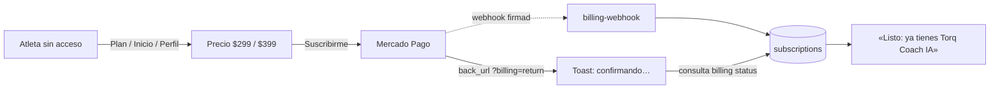
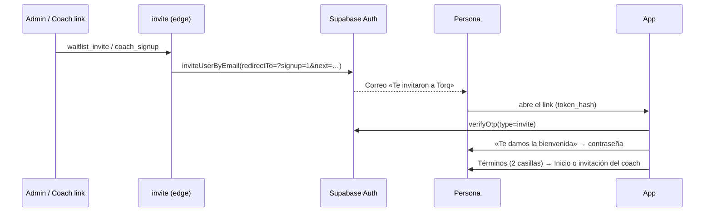

# Cobro, acceso y registro (modo de prueba)

Cómo encender lo que se implementó para **Torq Coach IA** ($399 MXN al mes,
$299 de fundador, IVA incluido, mes con mes), el acceso por plan, la
aceptación de términos y el **registro solo con invitación**. Las decisiones
de producto están en
[`evaluaciones/2026-10-20-ux-flujos.md`](evaluaciones/2026-10-20-ux-flujos.md)
(«Decisión de planes»).

> **Estado:** todo funciona en **modo de prueba**. Mientras no se configure
> Mercado Pago, el botón «Suscribirme» aparece apagado con el aviso «El cobro
> todavía no está activo (modo de prueba)». Los términos ya son la versión
> vigente (`TERMS_VERSION = '2026-10-20'`, decidido el 20-oct). La revisión de
> un abogado queda para después.

## Quién tiene la IA

La regla vive en `src/core/access.ts` (`aiAccess`) y la aplica el servidor en
`supabase/functions/_shared/access.ts`. La app solo muestra lo que el servidor
decide.

| Quién | ¿IA? | Por qué |
|---|---|---|
| Cuentas de cortesía (`COMP_USER_IDS`) | Sí | Equipo y pruebas |
| Coach aprobado (`profiles.is_coach`) | Sí, gratis | Torq no cobra a coaches |
| Atleta con coach vinculado (activo) **y que siga siendo coach** | Sí, gratis | «Torq va incluido por tu coach» |
| Suscripción autorizada y pagada | Sí | `paid_until` en el futuro |
| Cobro rechazado | Sí, 7 días | Gracia para actualizar la tarjeta |
| Canceló | Sí, hasta `paid_until` | Conserva lo que pagó |
| Nadie de lo anterior | No | Ve el precio antes del cuestionario |

Sin IA, los botones de Piñón siguen funcionando; la pregunta abierta y crear
plan explican el precio y llevan a «Conocer Torq Coach IA».



## Registro solo con invitación

No hay registro abierto. Una cuenta nace de un correo de invitación de
Supabase por uno de dos caminos (`supabase/functions/invite`):

1. **Lista de espera → «Invitar»** (solo administradores, `ADMIN_USER_IDS`):
   en la app, *Admin → Lista de espera*, un clic manda el correo y marca
   `waitlist.invited_at`.
2. **Link de coach** (`#/invite/<token>`): si quien lo abre no tiene cuenta,
   pone su correo y recibe la invitación. Solo funciona con un link vigente y
   sin usar.

El correo lleva a `<app>/?signup=1&next=…&token_hash=…&type=invite`; la app
canjea el token (`verifyOtp`), pide la contraseña, y sigue a la invitación del
coach o a Inicio. Después aparecen los términos.



## Coaches: solo por invitación y con solicitud aprobada

Nadie se registra como coach ni se vuelve coach desde la app: `profiles.is_coach`
lo protege un trigger y solo lo enciende el servidor al aprobar una solicitud
(`supabase/functions/coach-apply`, tabla `coach_applications`).

1. **Admin → Coaches → Invitar** (correo + máximo de atletas, default 20).
   Sin cuenta, le llega la invitación de Supabase y, al crear su contraseña,
   sigue a la solicitud. Con cuenta, le llega un correo (Resend) con el link.
   El link también se le muestra al admin. Vence en 14 días.
2. La persona abre `#/coach-apply/<token>` **con la cuenta de ese correo**
   (con otra cuenta no sirve: no se puede pasar el link) y llena la
   solicitud: nombre, teléfono, ciudad, años como coach, atletas que entrena
   hoy, certificaciones, disciplinas, cómo arma y ajusta los planes (≥ 80
   caracteres), dónde ver su trabajo, una referencia opcional, y tres
   declaraciones (información verdadera, responsable del entrenamiento de
   sus atletas y solo invitará a quien entrena, 18+). Puede corregirla
   mientras nadie la revisa.
3. **Admin → Coaches → Aprobar** (con su máximo de atletas) o **Rechazar**.

**Para que nadie finja tener coach para no pagar:**

| Hueco | Cómo se cierra |
|---|---|
| Volverse coach desde la app | Trigger en `profiles.is_coach`; solo la service role al aprobar. Probado en Postgres real. |
| Crear un vínculo o un link de coach sin ser coach | RLS: `coach_athletes` no se escribe directo; `coach_invites` solo si `is_coach`. Probado. |
| Pasar la invitación de coach a otra cuenta | La solicitud solo se abre con la cuenta del correo invitado. |
| Un coach reparte links a conocidos | Máximo de atletas activos por coach (`coach_seat_limit`, default 20). `accept_coach_invite` rechaza al llegar al máximo; el coach ve «20 de 20 atletas» y un aviso. El admin ve cuántos tiene cada uno. |
| Torq le quita el permiso a un coach | «Quitar como coach»: apaga `is_coach`, termina sus vínculos y borra sus links sin usar. Además, el acceso gratis solo cuenta si el coach **sigue** siendo coach, y un link de alguien que ya no es coach no se puede aceptar. |

Los coaches que ya se dieron de alta a mano (Joe, Diego) siguen igual, con
máximo de 20.

## Términos y mayores de 18

- Pantalla «Antes de empezar» (`src/ui/terms-gate.ts`) antes de usar la app:
  casilla 1 = términos y riesgos + «tengo 18 años o más»; casilla 2 =
  consentimiento expreso de datos de salud. «Ahora no» cierra la sesión.
- Evidencia en `legal_acceptances`: versión, SHA-256 del texto exacto,
  consentimientos, user-agent y fecha. Si cambia `TERMS_VERSION`, se vuelve a
  pedir.
- El cuestionario no acepta una fecha de nacimiento de menor de 18
  (`BODY_LIMITS.ageYears` en `src/core/coach-profile.ts`).
- Textos: `docs/legal/*-BORRADOR.md` → `src/core/terms-text.ts` y
  `privacy-text.ts`. Si un abogado los cambia después: actualizar el texto y
  subir `TERMS_VERSION`; a todos se les vuelve a pedir aceptarlo.
  (`TERMS_IS_DRAFT = true` vuelve a mostrar la etiqueta de borrador.)

## Configuración, paso a paso

Nada de esto se pega en el chat: las claves van como **secretos de Supabase**
(Dashboard → Edge Functions → Secrets, o `supabase secrets set`).

### 1. Base de datos

En Supabase → SQL Editor, pegar y correr
**`supabase/pendientes/2026-10-20-cobro-coaches-registro.sql`**: solo lo que
este cambio agrega sobre `main`, en una transacción (todo o nada) y
idempotente. Trae `waitlist`, `subscriptions`, `billing_events`,
`legal_acceptances`, `coach_applications`, `coach_seat_limit`,
`my_coach_seats` y la versión nueva de `accept_coach_invite` (revisa que
siga siendo coach y su máximo de atletas). Se probó sobre el `schema.sql` de
`main` en un Postgres 16 limpio, corriéndolo dos veces.

Para revisar que quedó: `select to_regclass('public.waitlist'), to_regclass('public.coach_applications');`
no debe regresar `null`.

`supabase/schema.sql` sigue siendo la fuente completa (para una base nueva).

### 2. Secretos

| Variable | Qué es |
|---|---|
| `MP_ACCESS_TOKEN` | Access token de Mercado Pago. En prueba, el que empieza con `TEST-` (credenciales de prueba). |
| `MP_WEBHOOK_SECRET` | Clave secreta del webhook (Mercado Pago → Webhooks → «Clave secreta»). |
| `MP_TEST_PAYER_EMAIL` | **Solo en pruebas:** el correo del usuario de prueba *comprador* de Mercado Pago. Mercado Pago exige que quien paga sea ese usuario; con esto se usa su correo en vez del de la cuenta de Torq. **Bórralo antes de cobrar de verdad.** |
| `APP_URL` | URL pública de la app (ya existía; la usan correos, regreso de Mercado Pago e invitaciones). |
| `TORQ_LAUNCH_DATE` | Día de lanzamiento, `YYYY-MM-DD`. El precio de fundador ($299) dura **60 días** contando ese día (`FOUNDER_DAYS` en `src/core/access.ts`); la app muestra «Precio de fundador hasta el …». Sin valor, todos pagan $399. |

### 3. Funciones

```sh
npx supabase login              # una vez; abre el navegador
./scripts/deploy-functions.sh   # publica las 8 con las banderas correctas
```

El script publica `billing`, `billing-webhook` (`--no-verify-jwt`: Mercado
Pago no manda sesión; se valida la firma), `invite`, `coach-apply`, y vuelve
a publicar `coach-chat`, `pinon-chat`, `coach-retire-plan` y
`monthly-self-report` (**`--no-verify-jwt`**: la llama el cron con
`x-cron-secret`; sin esa bandera el reporte mensual deja de correr).

> `invite` va con la verificación normal: sin sesión, la app llama con la
> llave pública (anon). Las acciones de administrador exigen sesión y que la
> cuenta esté en `ADMIN_USER_IDS`; `coach_signup` exige un link de coach
> vigente.

### 4. Mercado Pago

1. Crear la aplicación en *Tus integraciones* (producto: Suscripciones).
2. Webhooks → URL `<SUPABASE_URL>/functions/v1/billing-webhook`, eventos
   **Planes y suscripciones** (`subscription_preapproval` y
   `subscription_authorized_payment`). Copiar la clave secreta a
   `MP_WEBHOOK_SECRET`.
3. Para probar: crear dos **usuarios de prueba** (vendedor y comprador) y
   pagar con las tarjetas de prueba de Mercado Pago. Con el token de
   producción se cobra de verdad: no cambiarlo hasta tener la cuenta a nombre
   de la persona o empresa definida con el contador.

### 5. Supabase Auth (invitaciones)

1. Authentication → Email templates → **Invite user**: el botón del correo
   debe apuntar a

   ```
   {{ .RedirectTo }}&token_hash={{ .TokenHash }}&type=invite
   ```

   (el `RedirectTo` ya trae `?signup=1&next=…`; por eso va `&`).
2. Authentication → URL configuration → Redirect URLs: agregar
   `<APP_URL>/?signup=1*` (o `<APP_URL>/**`).
3. Authentication → Providers → Email: **desactivar «Allow new users to sign
   up»**. Las invitaciones siguen funcionando: las manda el servidor.

### 6. Quién es quién

- `COMP_USER_IDS` y `ADMIN_USER_IDS` en
  `supabase/functions/_shared/coach-access.ts` (redeploy al cambiarlos).
- Coaches: desde **Admin → Coaches** (invitar, aprobar, quitar). A mano en
  SQL sigue funcionando para casos especiales.

## Cómo se prueba

- Lógica: `src/core/access.test.ts`, `src/core/mercadopago.test.ts` (firma del
  webhook, cobro aprobado/rechazado), `src/core/coach-application.test.ts`.
- Base de datos: las reglas de coaches (no volverse coach, no escribir
  vínculos, máximo de atletas, coach quitado) se corrieron como el rol
  `authenticated` en un Postgres 16 local con `schema.sql` completo.
- Flujos: `e2e/nube/06-cobro-y-registro.spec.ts` con backend simulado —
  términos, menor de 18, suscribirse/volver/cancelar, cobro no configurado,
  gracia, Piñón sin acceso, atleta con coach, lista de espera, alta desde link
  de coach, link vencido; y `e2e/nube/07-coaches.spec.ts`: invitar coach,
  solicitud con huecos y completa, link con otra cuenta, sin invitación,
  aprobar con máximo, quitar como coach, coach al máximo, atleta con coach
  lleno. Capturas 70–80 en
  `evaluaciones/2026-10-20-ux/img/`.
- Pendiente con red real: un cobro de prueba de punta a punta con usuarios de
  prueba de Mercado Pago (desde este entorno no hay salida a Mercado Pago ni a
  Supabase).
