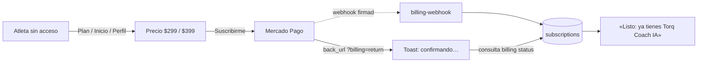
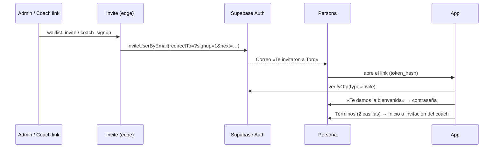

# Cobro, acceso y registro (modo de prueba)

Cómo encender lo que se implementó para **Torq Coach IA** ($399 MXN al mes,
$299 de fundador, IVA incluido, mes con mes), el acceso por plan, la
aceptación de términos y el **registro solo con invitación**. Las decisiones
de producto están en
[`evaluaciones/2026-10-20-ux-flujos.md`](evaluaciones/2026-10-20-ux-flujos.md)
(«Decisión de planes»).

> **Estado:** todo funciona en **modo de prueba**. Mientras no se configure
> Mercado Pago, el botón «Suscribirme» aparece apagado con el aviso «El cobro
> todavía no está activo (modo de prueba)». Los términos se muestran con la
> etiqueta de borrador (`TERMS_IS_DRAFT` en `src/core/terms-text.ts`) hasta que
> los revise un abogado.

## Quién tiene la IA

La regla vive en `src/core/access.ts` (`aiAccess`) y la aplica el servidor en
`supabase/functions/_shared/access.ts`. La app solo muestra lo que el servidor
decide.

| Quién | ¿IA? | Por qué |
|---|---|---|
| Cuentas de cortesía (`COMP_USER_IDS`) | Sí | Equipo y pruebas |
| Coach (`profiles.is_coach`) | Sí, gratis | Torq no cobra a coaches |
| Atleta con coach vinculado (activo) | Sí, gratis | «Torq va incluido por tu coach» |
| Suscripción autorizada y pagada | Sí | `paid_until` en el futuro |
| Cobro rechazado | Sí, 7 días | Gracia para actualizar la tarjeta |
| Canceló | Sí, hasta `paid_until` | Conserva lo que pagó |
| Nadie de lo anterior | No | Ve el precio antes del cuestionario |

Sin IA, los botones de Piñón siguen funcionando; la pregunta abierta y crear
plan explican el precio y llevan a «Conocer Torq Coach IA».



## Registro solo con invitación

No hay registro abierto. Una cuenta nace de un correo de invitación de
Supabase por uno de dos caminos (`supabase/functions/invite`):

1. **Lista de espera → «Invitar»** (solo administradores, `ADMIN_USER_IDS`):
   en la app, *Admin → Lista de espera*, un clic manda el correo y marca
   `waitlist.invited_at`.
2. **Link de coach** (`#/invite/<token>`): si quien lo abre no tiene cuenta,
   pone su correo y recibe la invitación. Solo funciona con un link vigente y
   sin usar.

El correo lleva a `<app>/?signup=1&next=…&token_hash=…&type=invite`; la app
canjea el token (`verifyOtp`), pide la contraseña, y sigue a la invitación del
coach o a Inicio. Después aparecen los términos.



## Términos y mayores de 18

- Pantalla «Antes de empezar» (`src/ui/terms-gate.ts`) antes de usar la app:
  casilla 1 = términos y riesgos + «tengo 18 años o más»; casilla 2 =
  consentimiento expreso de datos de salud. «Ahora no» cierra la sesión.
- Evidencia en `legal_acceptances`: versión, SHA-256 del texto exacto,
  consentimientos, user-agent y fecha. Si cambia `TERMS_VERSION`, se vuelve a
  pedir.
- El cuestionario no acepta una fecha de nacimiento de menor de 18
  (`BODY_LIMITS.ageYears` en `src/core/coach-profile.ts`).
- Textos: `docs/legal/*-BORRADOR.md` → `src/core/terms-text.ts` y
  `privacy-text.ts`. Al aprobar el abogado: cambiar `TERMS_VERSION`, poner
  `TERMS_IS_DRAFT = false`.

## Configuración, paso a paso

Nada de esto se pega en el chat: las claves van como **secretos de Supabase**
(Dashboard → Edge Functions → Secrets, o `supabase secrets set`).

### 1. Base de datos

Correr en el SQL editor la parte nueva de `supabase/schema.sql`
(`subscriptions`, `billing_events`, `legal_acceptances` y
`waitlist.invited_at`). Es idempotente.

### 2. Secretos

| Variable | Qué es |
|---|---|
| `MP_ACCESS_TOKEN` | Access token de Mercado Pago. En prueba, el que empieza con `TEST-` (credenciales de prueba). |
| `MP_WEBHOOK_SECRET` | Clave secreta del webhook (Mercado Pago → Webhooks → «Clave secreta»). |
| `APP_URL` | URL pública de la app (ya existía; la usan correos, regreso de Mercado Pago e invitaciones). |
| `TORQ_FOUNDER_UNTIL` | Último día con precio de fundador, `YYYY-MM-DD` (hora de CDMX). Sin valor, todos pagan $399. Propuesta: 60 días desde el lanzamiento. |

### 3. Funciones

```sh
supabase functions deploy billing
supabase functions deploy billing-webhook --no-verify-jwt   # Mercado Pago no manda sesión; se valida la firma
supabase functions deploy invite
# cambiaron por el acceso por plan:
supabase functions deploy coach-chat pinon-chat coach-retire-plan monthly-self-report
```

> `invite` va con la verificación normal: sin sesión, la app llama con la
> llave pública (anon). Las acciones de administrador exigen sesión y que la
> cuenta esté en `ADMIN_USER_IDS`; `coach_signup` exige un link de coach
> vigente.

### 4. Mercado Pago

1. Crear la aplicación en *Tus integraciones* (producto: Suscripciones).
2. Webhooks → URL `<SUPABASE_URL>/functions/v1/billing-webhook`, eventos
   **Planes y suscripciones** (`subscription_preapproval` y
   `subscription_authorized_payment`). Copiar la clave secreta a
   `MP_WEBHOOK_SECRET`.
3. Para probar: crear dos **usuarios de prueba** (vendedor y comprador) y
   pagar con las tarjetas de prueba de Mercado Pago. Con el token de
   producción se cobra de verdad: no cambiarlo hasta tener la cuenta a nombre
   de la persona o empresa definida con el contador.

### 5. Supabase Auth (invitaciones)

1. Authentication → Email templates → **Invite user**: el botón del correo
   debe apuntar a

   ```
   {{ .RedirectTo }}&token_hash={{ .TokenHash }}&type=invite
   ```

   (el `RedirectTo` ya trae `?signup=1&next=…`; por eso va `&`).
2. Authentication → URL configuration → Redirect URLs: agregar
   `<APP_URL>/?signup=1*` (o `<APP_URL>/**`).
3. Authentication → Providers → Email: **desactivar «Allow new users to sign
   up»**. Las invitaciones siguen funcionando: las manda el servidor.

### 6. Quién es quién

- `COMP_USER_IDS` y `ADMIN_USER_IDS` en
  `supabase/functions/_shared/coach-access.ts` (redeploy al cambiarlos).
- Coaches: `update profiles set is_coach = true where user_id = '…'` (solo a
  mano, ver `schema.sql`).

## Cómo se prueba

- Lógica: `src/core/access.test.ts`, `src/core/mercadopago.test.ts` (firma del
  webhook, cobro aprobado/rechazado).
- Flujos: `e2e/nube/06-cobro-y-registro.spec.ts` con backend simulado —
  términos, menor de 18, suscribirse/volver/cancelar, cobro no configurado,
  gracia, Piñón sin acceso, atleta con coach, lista de espera, alta desde link
  de coach, link vencido. Capturas 70–75 en
  `evaluaciones/2026-10-20-ux/img/`.
- Pendiente con red real: un cobro de prueba de punta a punta con usuarios de
  prueba de Mercado Pago (desde este entorno no hay salida a Mercado Pago ni a
  Supabase).
