# Evaluación de UX: entrar, sentirse bienvenido y hablar con Piñón
20 de octubre de 2026 · **Método:** pruebas de punta a punta con Playwright en Chromium real, contra la app corriendo en local con dos configuraciones: sin nube (modo local) y con un Supabase **simulado** (login, perfil, Piñón y coach IA). Cada prueba es una persona con un objetivo; se cuentan sus clics, campos y segundos de esfuerzo, y se guardan capturas como evidencia. · **Versión evaluada:** `main` en `d1ec0f4`. · **Suite:** `e2e/` (101 pruebas), `npm run test:ux`. · **Tres rondas el mismo día:** la primera encontró y arregló; la segunda aplicó tus respuestas a las preguntas abiertas ([Ronda 2](#ronda-2-tus-decisiones-y-lo-que-cambió)); la tercera implementó planes, cobro, términos y registro por invitación en modo de prueba ([Ronda 3](#ronda-3-cobro-términos-e-invitación-modo-de-prueba)).

**Decisiones de producto para esta revisión:**
- **Alcance:** pruebas, documentación y arreglos rápidos. Los cambios grandes de flujo quedan como propuesta.
- **IA evaluada:** el chat con Piñón y el coach que arma el plan.
- **Metas de clics (estrictas):**
  - ≤ 3 clics de abrir la app a hablar con Piñón.
  - ≤ 5 clics de abrir la app a estar rodando.
  - Cuestionario inicial ≤ 90 s de esfuerzo. *(Ronda 2: se retiró; el cuestionario no se acorta, se hace guiado.)*
- **Backend simulado:** desde el entorno de pruebas no hay red a producción.

**Limitaciones:**
- **La calidad de lo que contesta la IA real no se evaluó aquí.**
  - Las respuestas de Piñón y del coach son fijas: se prueba la experiencia alrededor (llegar, esperar, errores, seguir), no lo que diría Haiku o Sonnet.
  - La calidad del coach ya está medida en [`2026-10-09-hallazgos-coach-torq.md`](./2026-10-09-hallazgos-coach-torq.md).
  - La de Piñón ya tiene su arnés (`npm run pinon:eval`, ver Ronda 2), pero no se ha corrido: falta una API key válida en el entorno.
- **El Bluetooth real no se puede automatizar.** El camino «con rodillo» se mide hasta «Antes de empezar» y suma los 3 clics que faltan (conectar, elegir en el diálogo del navegador y Empezar).
- **El esfuerzo es una estimación**, inspirada en el modelo KLM:
  - 2.5 s por clic, 5 s por campo y 3 s por pausa a leer.
  - Los textos largos se leen a 200 palabras por minuto.
  - Sirve para comparar flujos entre sí, no como cronómetro.

---

## Resumen ejecutivo
- **Llegar a Piñón es fácil.**
  - Basta 1 clic desde Inicio, Plan, Forma e Historial, y 2 desde Perfil o Resumen. La meta era ≤ 3.
  - Los 6 botones rápidos contestan en 0.35–0.93 s, con 56–91 caracteres, sin llamar a la IA y sin siglas.
  - Pedir un cambio de plan se contesta sin IA y manda a quien sí puede hacerlo.
- **Rodar también es corto.**
  - Sin cuenta, una persona nueva está pedaleando en modo demo con **3 clics**.
  - Con plan y entreno del día, llega a «Antes de empezar» en **1 clic**: unos 4 en total con rodillo real.
- **Lo que más costaba antes de esta revisión**: 18 de 77 pruebas fallaban. Ahora fallan 0.
  - **Piñón le decía a una persona recién llegada «toca descansar»** cuando lo que pasaba era que no tenía plan (UX-12). Rompía justo la objetividad que pedimos.
  - **Al terminar el cuestionario no había siguiente paso** (UX-04): volvías a «Nada agendado».
  - **Tras crear el plan con el coach, el calendario seguía vacío** hasta recargar la app (UX-07).
  - **En celular, el botón de Piñón quedaba tapado** por la barra de pestañas (UX-16).
  - **La demo dejaba el simulador conectado.** «Empezar» quedaba habilitado y grababa una rodada falsa como real (UX-17).
  - **Errores en inglés** en el login y en el coach («Invalid login credentials», «Edge Function returned a non-2xx status code»).
- **Ronda 2, con tus decisiones** (22 de 89 pruebas fallaban antes; ahora pasan 88):
  - El cuestionario no se acorta: ahora es **paso a paso y guiado por Piñón**.
  - **Bienvenida de primera vez** con dos caminos claros.
  - **Concordancia de género** en toda la app, también en la IA.
  - **Piñón comenta cada sesión** en el Resumen.
  - **Lista de espera** en el login.
  - **Arnés de calidad de Piñón** listo para correr con la IA real.
  - De paso: **el modo local borraba todo al recargar** (UX-25), arreglado.
- **Planes decididos:** Coach IA a $399 al mes ($299 para fundadores) y coaching con Joe desde $1,260 ([decisión de planes](#decisión-de-planes-p-2)).
- **Ronda 3, en modo de prueba** (101 de 101 pruebas pasan):
  - **Acceso por plan** en el servidor: cortesía, coach, atleta con coach o suscripción. Reemplaza la lista fija de cuentas.
  - **Suscripción con Mercado Pago** lista; se enciende con las claves de prueba.
  - **Precio antes del cuestionario:** cierra UX-08. Antes, ~4 min para enterarse; ahora, 0–1 clic.
  - **Términos con dos casillas y solo mayores de 18**, con evidencia guardada.
  - **Registro solo por invitación:** botón «Invitar» en la lista de espera y alta desde el link del coach.
  - **El plan dice de quién es:** «Plan de Joe Hernández».
- **Lo que queda:** configurar Mercado Pago y Supabase ([guía](../cobro-y-registro.md)), revisar los textos con un abogado, y las preguntas fiscales.

## Ronda 2: tus decisiones y lo que cambió

### Tus respuestas y qué se hizo con cada una

| # | Pregunta | Tu decisión | Qué se hizo |
|---|---|---|---|
| 1 | ¿Cuestionario en dos tiempos? | **Todo es necesario: son entrenamientos serios y nadie arranca sin completarlo.** Puede ser más ameno e interactivo, no más corto. | ✅ **Cuestionario paso a paso guiado por Piñón.** Las mismas 29 preguntas en 9 pasos de ≤ 8 preguntas, con barra de progreso y puntitos para volver a cualquier paso ya visto. «Atrás» conserva lo contestado. Piñón explica para qué sirve cada paso y concuerda en género en cuanto eliges el sexo. «Siguiente» no deja avanzar con huecos y marca el campo. Se retiró la meta de 90 s: el esfuerzo se mide (~4 min) y se reporta. |
| 2 | ¿Quién usa la IA? | Todas las cuentas deberían tener IA; el coach humano sería para planes más caros; tal vez un plan gratis sin IA. **Hay que evaluar.** | ✅ **Decidido después:** Coach IA a $399 ($299 para fundadores) y coaching con Joe desde $1,260, sin plan gratis. Ver [Decisión de planes](#decisión-de-planes-p-2). |
| 3 | ¿Registro o invitación? | Que Piñón guíe el cuestionario. Me preguntas qué es mejor: no va a crecer exponencialmente, puede ser lista de espera. | ✅ **Recomiendo lista de espera, y está hecha.** El login ofrece «¿Sin cuenta? Únete a la lista de espera» (correo, y opcionalmente nombre y disciplina). La tabla `waitlist` solo acepta inserts y no se puede leer desde la app. Si el correo ya estaba, la respuesta es la misma, para no revelar quién está. ✅ Además, **bienvenida de primera vez** con Piñón (P-3). |
| 4 | Tono y género | Concordar con el perfil, hombre o mujer. | ✅ **Concordancia en toda la app.** Con «Hombre», masculino; con «Mujer», femenino; con «Otro» o sin dato, frases sin adjetivos de género (nunca el masculino genérico). Alcanza a: respuestas locales de Piñón, consejos, guías, Forma, bienvenida, el comentario en Resumen, la nota del ajuste semanal y **la IA de Piñón** (recibe `gender` y una regla nueva en su prompt). |
| 5 | ¿Piñón comenta cada sesión? | De acuerdo. | ✅ **Piñón en el Resumen** con un comentario de la sesión, sin IA: completa / a medias / se sintió más duro que los números / deriva de pulso / intenso pero fácil. Pide el RPE si falta y se actualiza al marcarlo. El chat de Piñón ahora también está en Resumen y en Perfil. |
| 6 | ¿Arnés de calidad de Piñón? | Sí, y documentado. | ✅ **Arnés hecho:** `npm run pinon:eval` con 4 perfiles × 27 preguntas (87 casos), 18 revisiones automáticas probadas, juez opcional con Sonnet y reporte en Markdown. Documentado en [`scripts/pinon-eval/README.md`](../../scripts/pinon-eval/README.md). ⏳ **No se ha corrido:** la key de Anthropic del entorno es inválida. Cuesta ~US$0.02 la corrida completa. |
| 7 | ¿Voz? | Aún no. | — |

### Lo que se encontró de paso (y se arregló)

| ID | Hallazgo | Severidad | Evidencia | Estado |
|---|---|---|---|---|
| UX-25 | **Sin nube (modo local), todo lo creado se borra al recargar.** `ensureLocalDataOwnership` quitaba la marca de dueño sin sesión, y en el siguiente arranque `null ≠ ''` borraba IndexedDB. El README promete que el modo local funciona al 100 %. | **Alta** (datos) | `local/01 › sin cuenta, lo que creas sobrevive a recargar` | ✅ Arreglado |
| UX-26 | Recargar la página en el Resumen (o abrir su enlace) mostraba «Todavía no hay ninguna sesión»: el Resumen no leía el `:id` de la ruta | Media | `nube/05 › … la sesión abre por enlace` | ✅ Arreglado: `#/session/<id>` |
| UX-27 | El Resumen decía «…, completo» aunque la sesión fuera parcial | Baja | revisión de código | ✅ «…, a medias» |
| UX-28 | Etiquetas en inglés en el Resumen: «Variability Index», «Efficiency Factor» | Baja | `nube/05 › …` | ✅ «Índice de variabilidad», «Factor de eficiencia» |

**Antes de esta ronda, 22 de las 89 pruebas nuevas fallaban; ahora pasan 88**, y la que queda es la deuda UX-08, que depende de la decisión de planes. Tablas: [ronda 2 antes](./2026-10-20-ux/resultados-ronda2-antes.md) · [después](./2026-10-20-ux/resultados-despues.md).

### Evidencia

| Antes | Después |
|---|---|
|  Primer Inicio: «Nada agendado 🌙» y un aviso. | 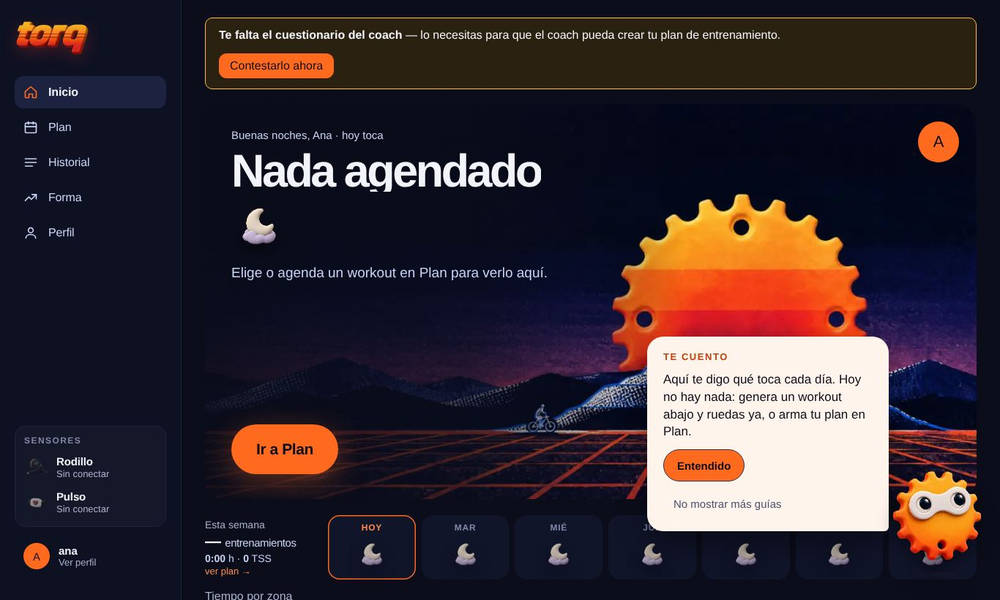 «Te damos la bienvenida, Ana · ¿Por dónde empezamos?» Piñón explica y ofrece dos caminos. |
| 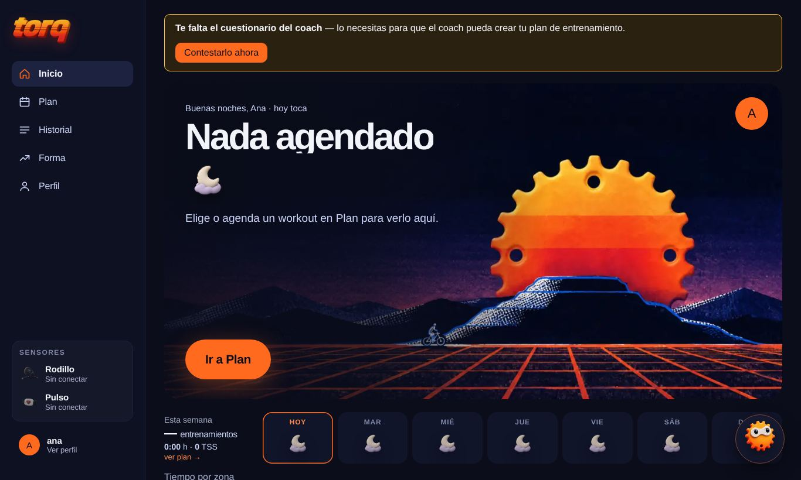 Un formulario de 9 secciones con scroll. | 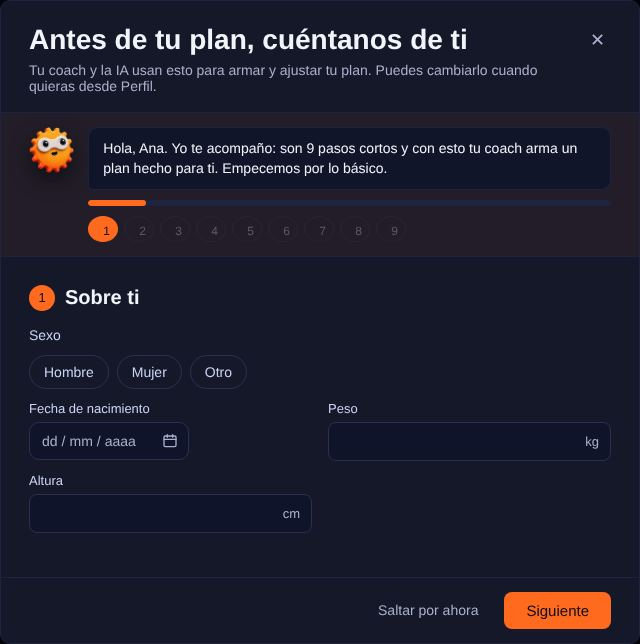 Paso 1 de 9, con Piñón y progreso. [Paso 8](./2026-10-20-ux/img/08-cuestionario-paso-8.jpg): «¿Lista? Ya casi terminamos.» |
| 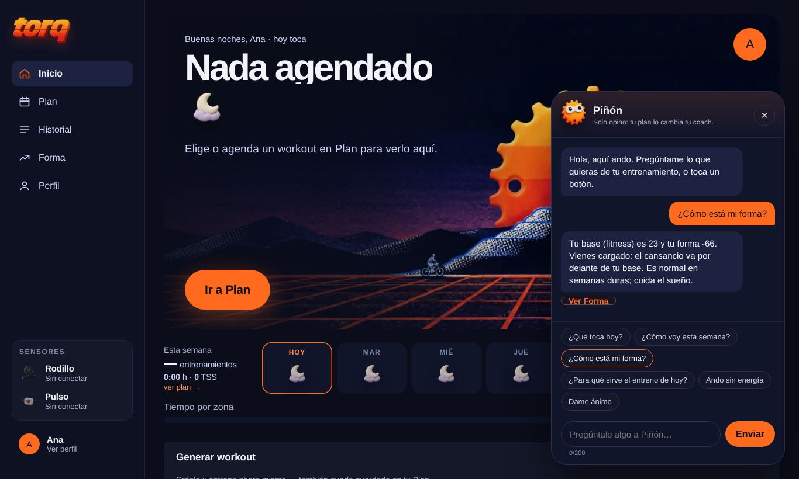 Ana: «Vienes cargado». | 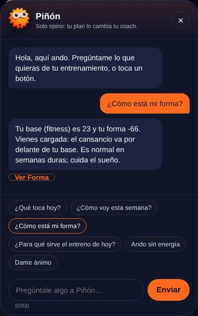 Ana: «Vienes cargada». |
| 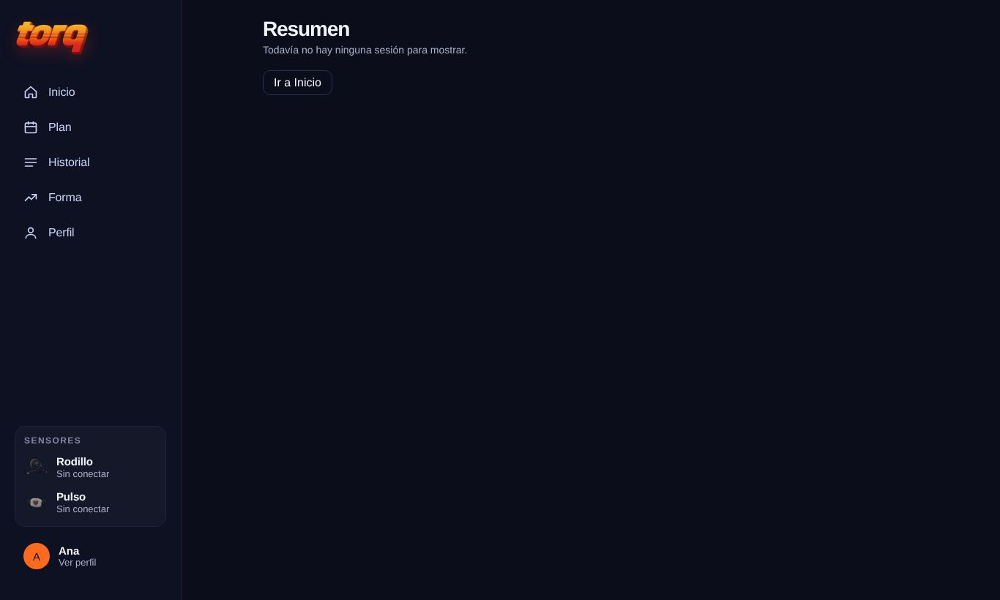 Resumen sin comentario (aquí, abierto por enlace: vacío). | 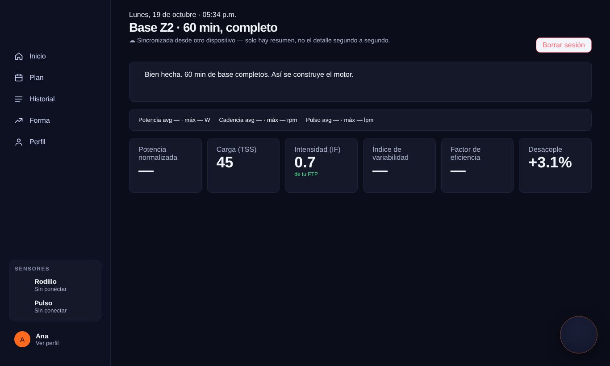 «Bien hecha. 60 min de base completos…» y el chat a la mano. |
|  Login sin salida para quien no tiene invitación. | 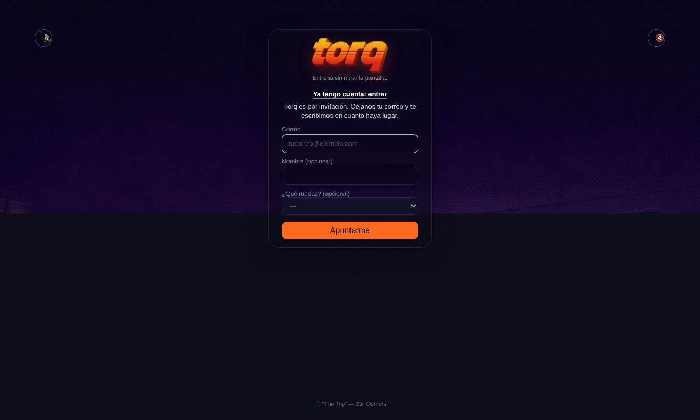 Lista de espera en 1 clic, con 1 campo obligatorio. |

Más evidencia:
- [Bienvenida en celular](./2026-10-20-ux/img/51-movil-home.jpg)
- [Guía de Forma en femenino](./2026-10-20-ux/img/61-guia-forma-ana.jpg)

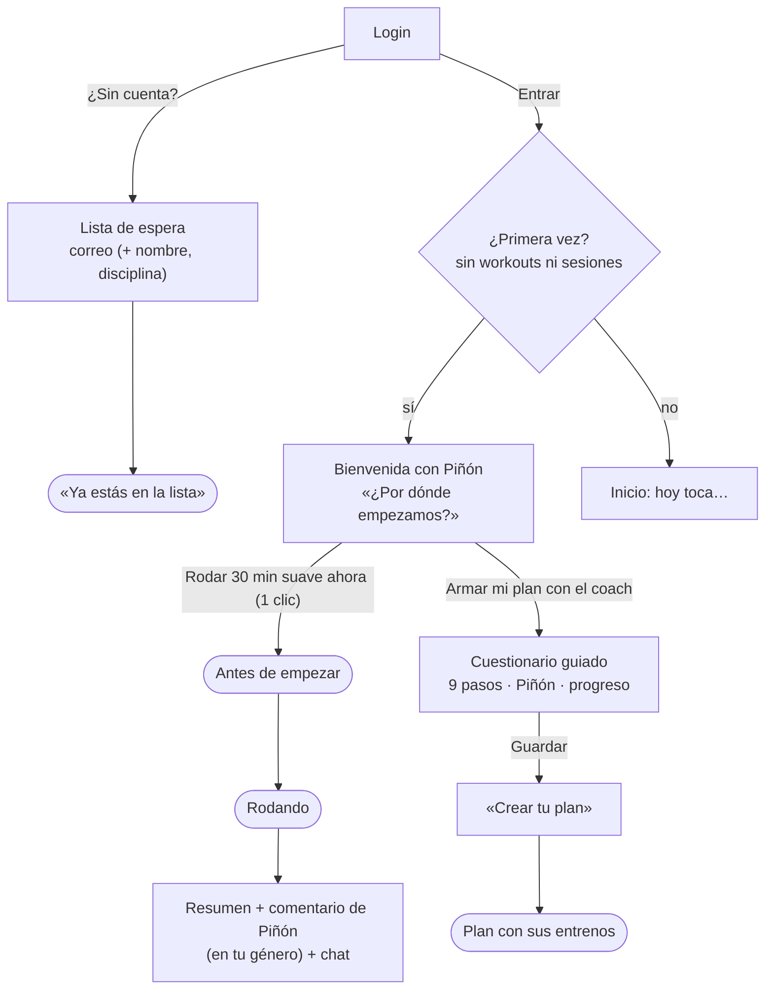

### Decisión de planes (P-2)

Se decidió en la conversación del 20-oct. Precios en **MXN al mes, IVA incluido, mes con mes**.

| Quién | Qué paga a Torq | Qué incluye |
|---|---|---|
| **Atleta sin coach (Torq Coach IA)** | **$399** · **$299 para fundadores**: los primeros usuarios, mientras mantengan su suscripción; se propone definirlos por fecha, los primeros 60 días | Cuestionario guiado, plan con tus datos, ajuste cada semana, control del rodillo, Piñón diario y comentario de cada sesión |
| **Coach** (Joe y los que inviten) | **Nada.** Torq no cobra a los coaches ni procesa sus pagos | Vista del coach, borradores de la IA, revisión mensual, reportes |
| **Atleta de un coach** | **Nada a Torq.** Le paga a su coach el precio que el coach decida (Joe: desde $1,260) | Todo Torq, mientras esté vinculado |

**El modelo:** Torq apoya a los coaches, no toca su dinero. El negocio son los atletas que entrenan sin coach.

**Joe Hernández es coach y parte del equipo fundador.** Eso tiene tres consecuencias:
- **Respalda el Coach IA, pero sin quedar como responsable de cada plan.** El plan se construye con su método (cuestionario, rampa por RPE, reglas del plan), pero si la IA se equivoca no debe recaer en su nombre.
  - En precios: «Desarrollado con coaches de ciclismo», sin nombre.
  - Si Joe quiere, en «Quiénes somos»: «Con la asesoría de Joe Hernández», junto a que es cofundador.
  - Nunca «el método de Joe» ni «Joe revisa tu plan».
  - Siempre claro que el plan lo arma una IA, y en los términos y al aceptar el plan: «Es una guía de entrenamiento, no consejo médico».
- **No hay conflicto entre el Coach IA y sus planes:** gana con los dos.
- **Se cuida la confianza de los otros coaches:**
  - todos aparecen en la vitrina con las mismas condiciones;
  - ningún coach ve los datos de los atletas de otro, ni Joe como fundador;
  - se dice abiertamente que Joe es cofundador.

**Reglas:**
- **Los coaches entran por invitación.**
- **Torq nunca le ofrece su plan a un atleta mientras tenga coach.**
- **Si el vínculo termina,** el atleta puede seguir solo con Coach IA, con su historial.
- **A quien entrena solo y quiere más,** Torq le muestra «Conoce a los coaches que usan Torq», sin comisión.

**Lo que cuesta un atleta de coach:** ~$8.40 de IA al mes más su parte de los fijos.
- 20 atletas (Joe): ≈ $170–370 al mes, que cubren 1–2 atletas sin coach a $299.
- 200 atletas (10 coaches): ≈ $1,700–3,500 al mes, que cubren 8–15.

**Lo que se descartó y por qué:**
- **Plan gratis permanente.** Son entrenamientos serios: nadie arranca sin el cuestionario.
- **Contador de lugares para Joe.** Joe avisa cuando ya no pueda.
- **$249.** Queda abajo de apps que hacen menos (ver tabla) y comunica «app menor».
- **Cuota a los coaches** ($79–99 por atleta activo) y **que Torq cobre a los atletas en nombre del coach**: descartadas. Torq no toca el dinero de los coaches.
- **Plan intermedio «Revisión de Joe» (~$899).** Por ahora no: se corre el riesgo de que Joe haga el mismo trabajo por menos.
  - Se reconsidera a los 2–3 meses, con el tiempo real que Joe le dedica a cada atleta medido en la app.
  - Si se abre, se llama «Revisión», no «Coach», y la app pone los límites:
    - Joe aprueba el borrador de la IA; si no lo revisa en 48 h, sale el de la IA.
    - Revisión mensual con la pantalla que ya existe.
    - 2 mensajes al mes con respuesta en 72 h.
    - Meta: ≤ 30 minutos de Joe por atleta al mes.

**Contra qué se compara** (búsqueda del 20-oct; verificar antes de publicar):

| App | Qué es | Precio | ≈ MXN al mes |
|---|---|---|---:|
| NUA | Coach IA por WhatsApp/Telegram, sin control del rodillo | €19.95 mes con mes | ≈ $430 |
| Leon (coachleon.ai) | Coach IA | No se publica (7 días de prueba) | ? |
| TrainerRoad | Planes + rodillo, sin coach | US$21.99 | ≈ $420 + impuestos |
| Zwift | Rodillo/juego, sin coach | US$19.99 + impuestos | ≈ $440 |
| TrainingPeaks Premium | Registro y análisis | ~US$19.95 | ≈ $380 |

**Posicionamiento:** «Tu rodillo y tu coach en una sola app.» Torq hace lo de TrainerRoad o Zwift y lo de NUA o Leon, en español de México y cobrando en pesos.

#### Incentivos para que los coaches usen Torq

Ser gratis quita la barrera; que lo adopten depende de que Torq les **traiga clientes, les ahorre tiempo y los haga quedar bien**.

| # | Incentivo | Qué gana el coach | Cuándo |
|---|---|---|---|
| 1 | Vitrina «Conoce a los coaches que usan Torq», para quien entrena solo | Clientes nuevos, sin comisión | Después del lanzamiento |
| 2 | Su marca en la app, los correos y los PDF («Plan de Joe Hernández») | Se ve profesional; Torq es su herramienta | **Lanzamiento** |
| 3 | «Esta semana Torq te ahorró X horas», con el tiempo medido por atleta | Ve el valor y tiene argumento para recomendarlo | Después del lanzamiento |
| 4 | Pase de prueba de 2 semanas para sus prospectos | Le ayuda a vender sus planes | Después |
| 5 | La IA arma los borradores con su biblioteca de sesiones | Planes con su estilo | Después |
| 6 | Gratis para siempre para los coaches fundadores, por escrito | Confianza para mover a todos sus atletas | **Lanzamiento** |
| 7 | Alta acompañada de sus primeros atletas | Empieza sin fricción | **Lanzamiento** |
| 8 | Línea directa para pedir funciones | Siente que Torq se hace con él | Siempre |

**Se evita:** pagarle a un coach por traer atletas al plan de IA. Lo pondría a vender Torq contra sus propios planes.

#### Costo de la IA por usuario (medido en `coach-lab`, caché fría, ~$19 MXN por dólar)

| Acción | Modelo | MXN por uso |
|---|---|---:|
| Crear plan o bloque nuevo (+ descripciones, + reintento promedio) | Sonnet 5.5 | ≈ $2.90 |
| Ajuste semanal normal / con test o FTP | Haiku 5.5 / Sonnet 5.5 | ≈ $0.09 / ≈ $1.16 |
| Mensaje a Piñón con IA (los botones no usan IA) | Haiku 5.5 | ≈ $0.005 |
| Reporte mensual | Haiku 5.5 | ≈ $0.08 |

| Usuario | IA al mes |
|---|---:|
| Ligero | ≈ $3.50 |
| Típico, primer mes (crea y rehace el plan) | ≈ $7.60 |
| Típico, meses siguientes | ≈ $4.70 |
| Intenso | ≈ $16.50 |
| Tope duro que permite el código (500 mil tokens del coach + 10 mensajes diarios a Piñón) | ≈ $44 |

Para los números se usa **$8 al mes** como promedio conservador. El costo real por usuario se sacará de `coach_calls` (vista `coach_cost_by_mode`) cuando haya usuarios de pago.

#### Costos fijos

| Servicio | Hoy | Cuándo pasar a pago | Costo |
|---|---|---|---|
| Supabase | Gratis | **Al cobrar al primer usuario** (el plan gratis se pausa por inactividad y no tiene respaldos) | US$25 ≈ $475 |
| Correos (Resend) | Gratis | ~80–100 usuarios (tope de ~100 correos al día) | US$20 ≈ $380 |
| Hosting (Cloudflare Workers) | Gratis | No a esta escala | $0 |
| Dominio | Pago anual | — | ≈ $24 |

Hoy los fijos son $0: solo hay 3 cuentas de prueba.

#### Lo que queda por usuario

| Usuarios de pago | Fijos por usuario | Neto con $399 | Neto con $299 (fundador) |
|---|---:|---:|---:|
| 10 | $50 | ≈ $266 | ≈ $184 |
| 25 | $20 | ≈ $296 | ≈ $214 |
| 50 | $10 | ≈ $306 | ≈ $224 |

Cuenta: precio sin IVA (÷ 1.16) − Stripe (3.6 % + $3 + IVA de la comisión) − IA $8 − fijos. Con 2 usuarios de pago ya se cubre Supabase Pro.

#### Cómo se comunica

> **Torq Coach IA · $399 al mes**
> Tu rodillo y tu coach en una sola app. Desarrollado con coaches de ciclismo, tu plan se ajusta cada semana a lo que de verdad rodaste. Piñón te acompaña todos los días.
> *Si vienes de la lista de espera: $299 al mes mientras mantengas tu suscripción.*
>
> **¿Ya tienes coach y usa Torq?** La app va incluida.
>
> Mes con mes. IVA incluido.
>
> **Torq para coaches · gratis.** Lleva a tus atletas con la IA de tu lado: borradores de cada semana con sus datos reales, revisión mensual y control del rodillo. Tú pones tu precio y cobras como siempre; Torq no toca tu dinero.

**Reglas:**
- **El precio se ve antes del cuestionario.** Nunca después del esfuerzo.
- **«Conoce a los coaches que usan Torq»** aparece para quien entrena solo desde la semana 4, y solo en momentos donde aporta: carrera agendada, lesión, cansancio que se repite, o algo que Piñón no puede resolver.
- **Nunca se ofrece después de una sesión mala,** ni insinuando que la IA no alcanza.
- **A los atletas con coach, nunca se les ofrece nada.**

#### Pendiente
1. ~~Con Joe: ¿Torq va incluido en sus planes?~~ **Decidido: sí, va incluido**, y los coaches no le pagan nada a Torq.
2. **Pasarela de cobro:** Mercado Pago (recomendado), a nombre de Andrea.
   - **Fiscal:** confirmar con un contador el alta en el SAT (RESICO persona física parece lo más simple), la actividad a registrar, la facturación (CFDI y factura global) y si Mercado Pago retiene impuestos.
   - **Con varios fundadores (Diego, Andrea y Joe), una S.A.S. suele tener más sentido** que cobrar a nombre de una persona física: deja claro de quién es Torq, separa el dinero y pone Mercado Pago y las facturas a nombre de la sociedad.
   - Hasta donde sabemos, una persona en RESICO no puede ser socia de una persona moral: confirmarlo con el contador.
3. **Fundadores:** confirmar la fecha límite (se proponen los primeros 60 días después del lanzamiento).
4. **Términos y aviso de privacidad.** Hay borradores en [`docs/legal/`](../legal/) para que los revise un abogado.
   - **Decidido:** se aceptan con un clic y dos casillas (términos con riesgos y uso de datos de salud), con registro de fecha, versión, hash y dispositivo, y copia por correo.
   - **Solo mayores de 18.**
   - Cada coach puede agregar sus propios términos al invitar a un atleta.
3. **Implementación** (estado tras la [Ronda 3](#ronda-3-cobro-términos-e-invitación-modo-de-prueba)):
   - ✅ acceso por plan (cortesía / coach / atleta con coach / suscripción) en lugar de `ALLOWED_USER_IDS`;
   - ✅ suscripción con Mercado Pago, solo para atletas sin coach (modo de prueba);
   - ✅ precio antes del cuestionario;
   - ⏳ la vitrina «Conoce a los coaches que usan Torq» y los momentos para mostrarla;
   - ⏳ la medición del tiempo de Joe por atleta.

---

## Ronda 3: cobro, términos e invitación (modo de prueba)

Pediste «empieza a implementar en modo de prueba», y después: **registro solo con invitación**, con **botón en la app** para invitar desde la lista de espera. Todo está detrás de configuración: sin las claves de Mercado Pago, el botón de pagar se ve apagado y lo dice. Cómo encenderlo: [`docs/cobro-y-registro.md`](../cobro-y-registro.md).

### Qué se construyó

| Pieza | Dónde | Qué ve la persona |
|---|---|---|
| Acceso por plan | `src/core/access.ts` (regla) · `_shared/access.ts` (servidor) | Coach, atleta con coach y cortesía: IA sin pagar. Los demás: precio. Siete días de gracia si falla un cobro; si cancela, conserva lo pagado. |
| Suscripción | `functions/billing` · `functions/billing-webhook` · `src/core/mercadopago.ts` | «Suscribirme con Mercado Pago» → paga allá → vuelve y ve «Listo: ya tienes Torq Coach IA». En Perfil, «Tu plan»: precio, pagado hasta, cancelar en dos pasos. |
| Seguridad del cobro | `verifyMpSignature` | Cada aviso de Mercado Pago se valida con su firma y se procesa una sola vez. El estado nunca se toma del aviso: se vuelve a pedir a Mercado Pago. |
| Precio de fundador | `TORQ_FOUNDER_UNTIL` | $299 si se suscribe antes de la fecha límite (hora de CDMX), y se conserva mientras siga activa. Después, $399. |
| Términos y 18+ | `src/ui/terms-gate.ts` · `legal_acceptances` | «Antes de empezar»: dos casillas (términos y riesgos con «tengo 18 años o más», y datos de salud). Se guarda versión, hash del texto, fecha y dispositivo. El cuestionario rechaza a menores. |
| Registro por invitación | `functions/invite` · `src/ui/invite-signup.ts` | Sin registro abierto. Admin → Lista de espera → «Invitar» (1 clic). Quien abre el link de su coach sin cuenta pone su correo y crea su contraseña al volver. |
| Marca del coach | `calendar.ts` · `home.ts` · Perfil | «Plan de Joe Hernández» en Plan, «· plan de Joe» en el saludo y «Torq va incluido por tu coach» en Perfil, sin precios. |
| Piñón sin acceso | `pinon-chat` | Los botones siguen funcionando; la pregunta abierta dice «vienen con Torq Coach IA» y ofrece conocerlo. |

### Flujo

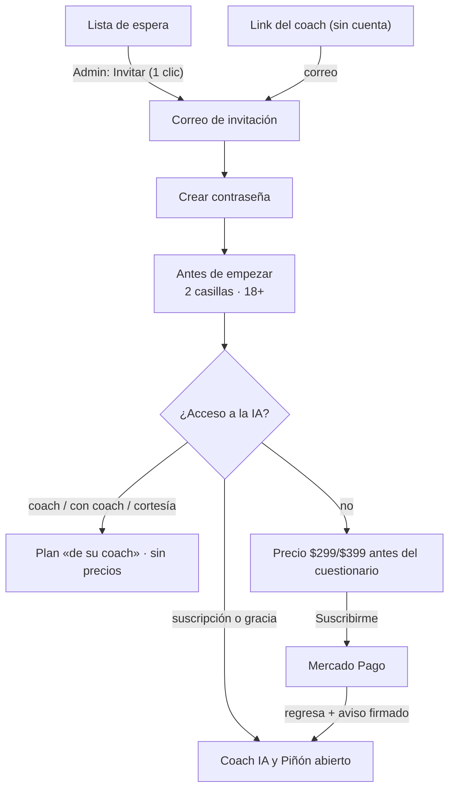

### Evidencia

| | |
|---|---|
| 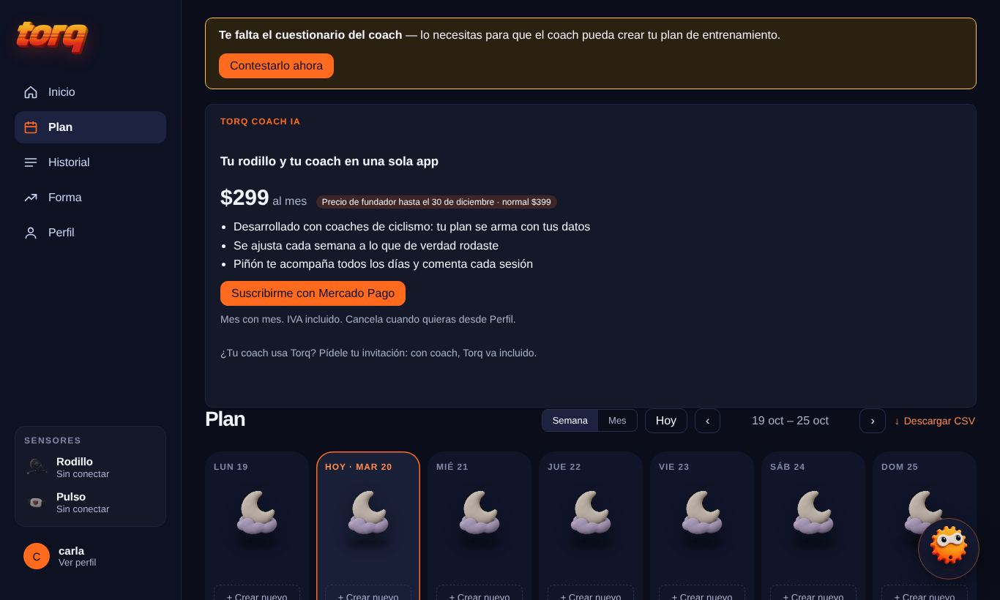 **Sin acceso:** Plan muestra el precio en vez de abrir 29 preguntas. | 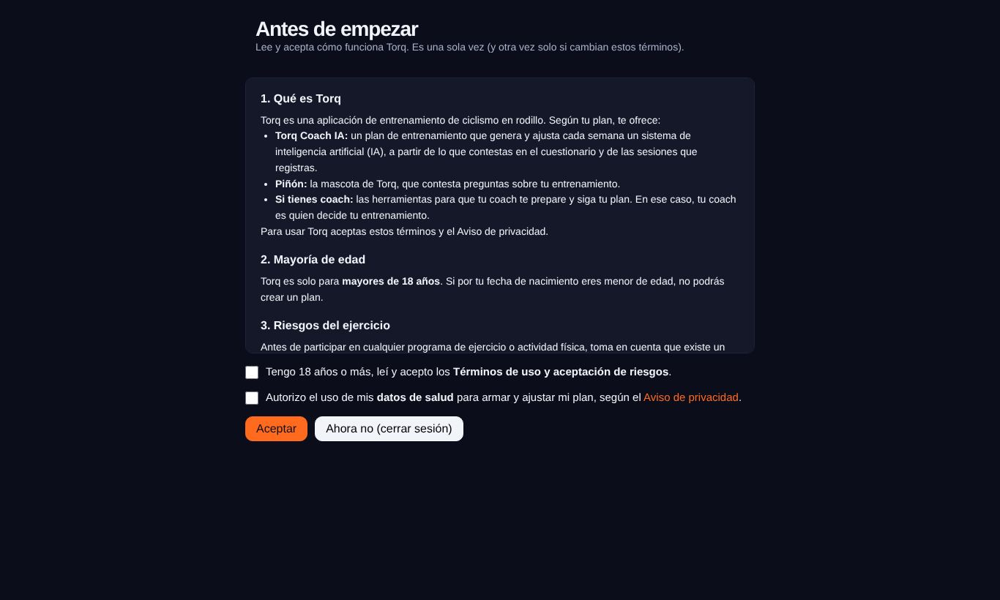 **Antes de empezar:** borrador marcado, dos casillas, «Ahora no» cierra sesión. |
| 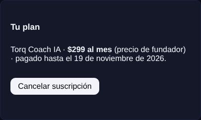 **Tu plan** en Perfil, suscrita a precio de fundador. | 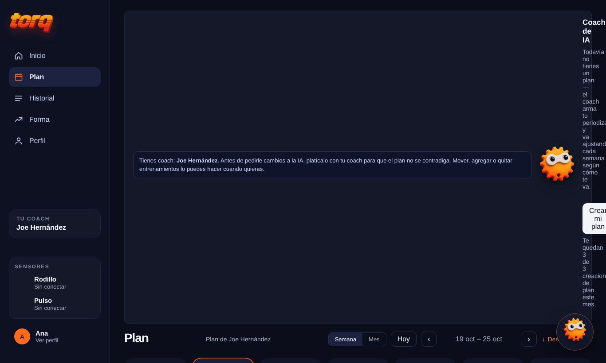 **Atleta de Joe:** «Plan de Joe Hernández», sin precios. |
| 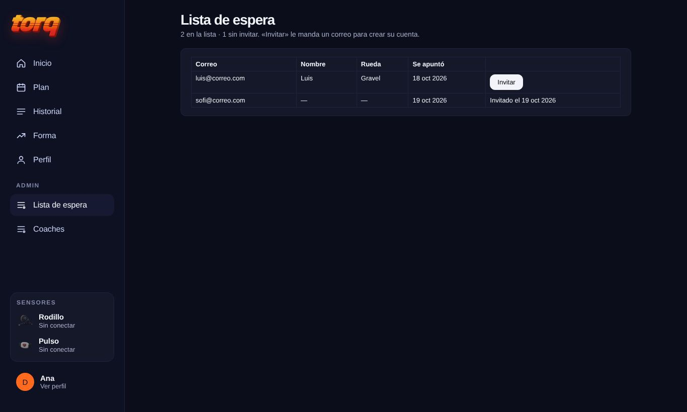 **Admin:** lista de espera con «Invitar» y fecha de invitación. | 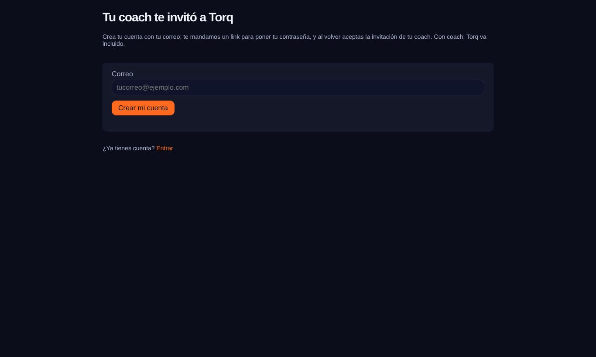 **Link de coach sin cuenta:** un campo y listo. |

### Pruebas nuevas

- `e2e/nube/06-cobro-y-registro.spec.ts`: 12 escenarios (términos, menor de 18, suscribirse/volver/cancelar, cobro no configurado, gracia, Piñón sin acceso, atleta con coach, admin y no-admin, alta desde link de coach, link vencido).
- `nube/03`: la deuda UX-08 se convirtió en dos pruebas normales. Una mide el esfuerzo para ver el precio: ≤ 1 interacción, cuando antes eran 32.
- Unitarias: `access.test.ts` (quién tiene IA, fecha de fundador) y `mercadopago.test.ts` (firma válida, alterada o vieja; cobro aprobado o rechazado).
- **Resultado:** 101 de 101 E2E, 577 unitarias, `tsc` y el chequeo de `core.gen.js` limpios.

### Lo que falta y no se puede hacer desde aquí

- **Encender Mercado Pago en prueba** y hacer un cobro de punta a punta con usuarios de prueba. Desde este entorno no hay salida a Mercado Pago ni a Supabase. Pasos en la [guía](../cobro-y-registro.md).
- **Plantilla del correo de invitación** en Supabase y **apagar el registro abierto** (también en la guía).
- **Abogado:** revisar los textos. Al aprobarlos, se sube `TERMS_VERSION` y se quita la etiqueta de borrador. A quien ya aceptó se le vuelve a pedir.
- **Contador:** RESICO o S.A.S., y a nombre de quién queda la cuenta de Mercado Pago. No usar el token de producción antes de eso.
- **Fecha de fundador:** confirmar los 60 días y ponerla en `TORQ_FOUNDER_UNTIL`.

---

## Metas: antes y después

| Meta | Medido antes | Medido después | Estado |
|---|---|---|---|
| Abrir la app → hablar con Piñón (≤ 3 clics) | 1 clic (2 desde Perfil/Resumen) | igual | ✅ |
| Respuestas de botones al instante y sin IA | 0.35–0.93 s · 0 llamadas | igual | ✅ |
| Respuesta de Piñón objetiva para alguien nuevo | «Hoy no tienes nada agendado: toca descansar» | «Todavía no tienes plan…» + «Ver mi plan» | ✅ arreglado |
| Abrir la app → rodando, sin cuenta (≤ 5 clics) | 3 clics | 3 clics | ✅ |
| Abrir la app → rodando, con plan (≤ 5 clics) | 1 + 3 con rodillo = 4 | igual | ✅ |
| Login → Inicio | 2 clics + 2 campos; Enter no hacía nada | Enter entra | ✅ arreglado |
| ~~Cuestionario ≤ 90 s~~ → cuestionario guiado | ~244–249 s en un solo formulario | ~4 min en 9 pasos guiados, ≤ 8 preguntas por paso | ✅ meta cambiada (ronda 2) |
| Primera vez → rodar | Generar y entrenar, abajo en Inicio | «Rodar 30 min suave ahora» en la bienvenida: 1 clic | ✅ ronda 2 |
| Cuestionario → siguiente paso claro | volvía a Inicio «Nada agendado» | abre «Crear tu plan» | ✅ arreglado |
| Perfil completo → plan creado (≤ 8 interacciones) | 8, pero calendario vacío | 8, calendario con el plan | ✅ arreglado |
| IA colgada no deja «escribiendo…» para siempre | se quedaba para siempre | a los 25 s avisa y deja seguir | ✅ arreglado |

Tablas completas por prueba: [ronda 1 antes](./2026-10-20-ux/resultados-antes.md) · [ronda 2 antes](./2026-10-20-ux/resultados-ronda2-antes.md) · [después](./2026-10-20-ux/resultados-despues.md).

---

## Cómo se probó

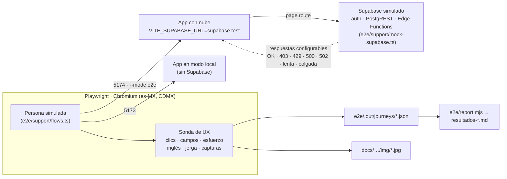

### Personas

| Persona | Quién es | Estado inicial | Dónde se usa |
|---|---|---|---|
| **Ana**, novata | Mujer, 34 años, sin estructura, sin FTP ni pulso máx. | Cuenta nueva, sin perfil, sin plan | Primer ingreso, cuestionario, chat «nueva», coach |
| **Beto**, experimentado | Hombre, 41, XC, FTP 265 W, FC máx. 186 | Perfil completo; entreno de hoy o plan activo | Cuestionario, chat «con entreno», volver a rodar |
| **Carla**, sin acceso | Cuenta que no está en la lista del coach IA | Sin perfil | Coach 403, chat 403 |
| **Sin cuenta** | Quien abre un despliegue sin nube | Nada | Modo local, demo, celular |
| **Celular** | Cualquiera en un iPhone 13 (390×664) | Nada | Recorrido de pantallas, chat |

### Matriz de comportamientos

| Comportamiento | Ana | Beto | Carla | Sin cuenta | Celular |
|---|:-:|:-:|:-:|:-:|:-:|
| Entra con Enter, se equivoca de contraseña, deja campos vacíos | ✓ | | | | |
| Link profundo sin sesión (`#/form`) | ✓ | | | | |
| Lee la guía de Piñón / la apaga | ✓ | | | ✓ | |
| Contesta el cuestionario con prisa / lo deja incompleto / lo salta | ✓ | ✓ | | | |
| Abre a Piñón desde cada pantalla | | ✓ | | ✓ | ✓ |
| Toca cada botón rápido (5 × 2 perfiles) | ✓ | ✓ | | ✓ | |
| Pregunta libre · repetida (caché) · pide un cambio · doble clic · 250 caracteres | | ✓ | | ✓ | |
| IA: 403 · 429 · 500 · lenta 8 s · colgada 60 s | | ✓ | ✓ | | |
| Crea plan · reintenta tras 502/500 · doble clic en «Crear plan» | ✓ | | ✓ | | |
| Vuelve con entreno hoy / tras 6 días sin rodar | | ✓ | | | |
| Demo sin rodillo y regreso a «Antes de empezar» | | | | ✓ | |
| Sin scroll horizontal, Piñón visible y chat dentro de la pantalla | | | | | ✓ |

---

## Flujos

### 1. Primer ingreso (nube)

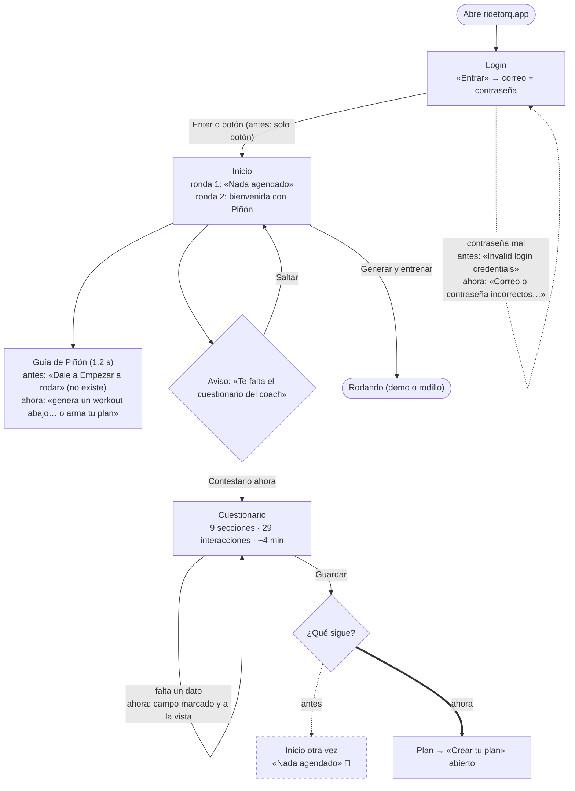

| Antes | Después |
|---|---|
| 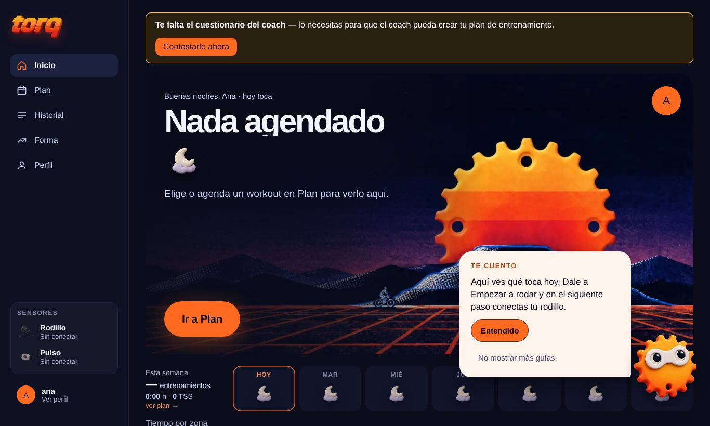 La guía promete un botón que no está. |  Ronda 2: la bienvenida reemplaza a la guía en la primera visita. Con algo agendado, la guía describe lo que sí hay. |
| 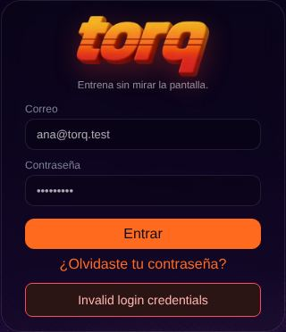 | 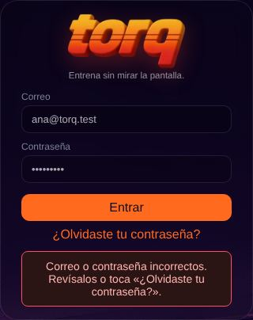 |
| 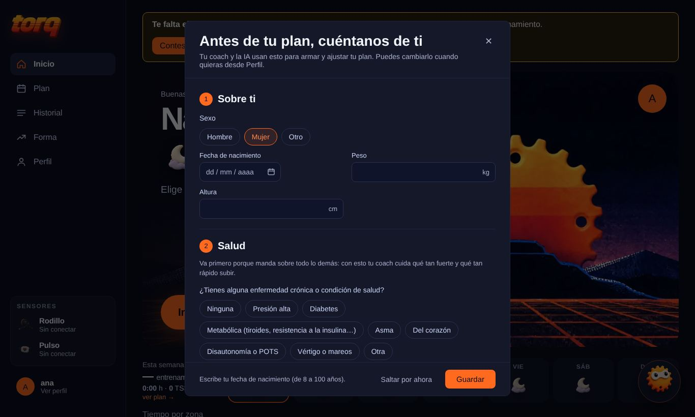 Solo un texto al pie. | 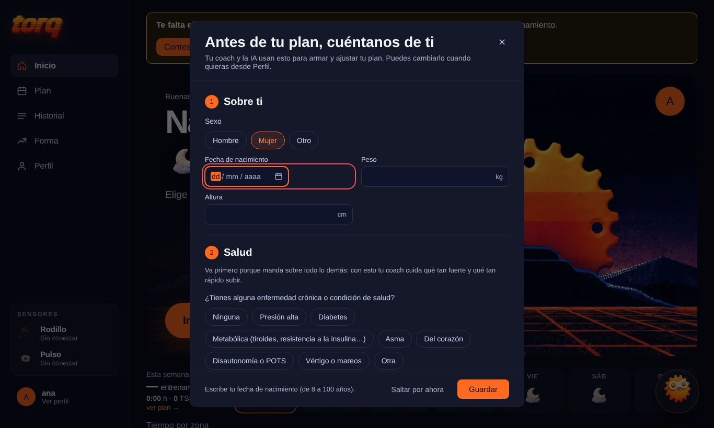 El campo queda marcado, centrado y con el foco. |
| 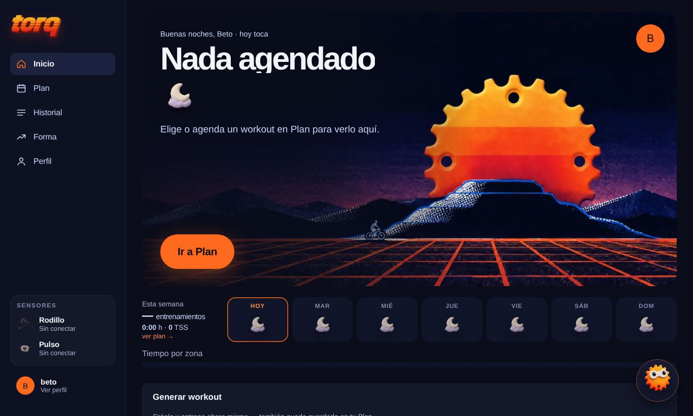 Vuelve a Inicio sin siguiente paso. | 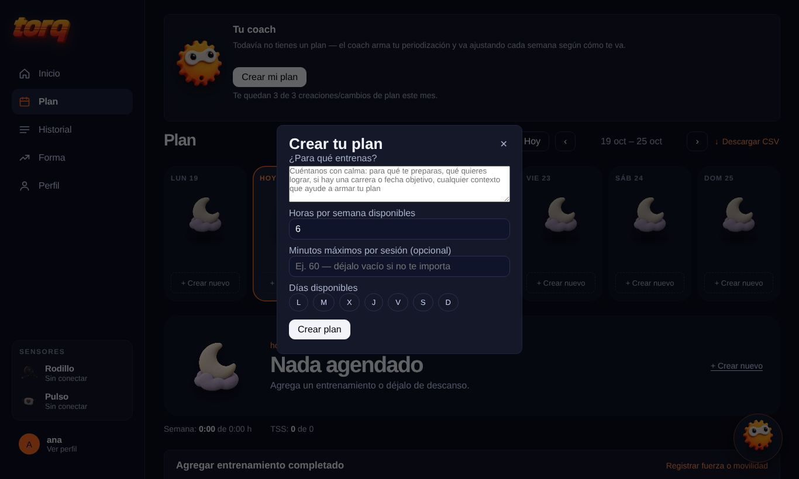 Sigue directo a «Crear tu plan» (días L M **X** J V S D). |

### 2. Hablar con Piñón

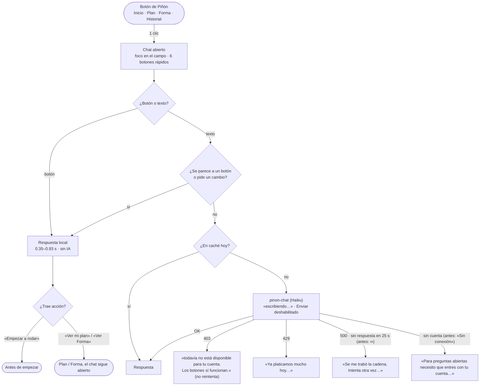

| Situación | Antes | Después |
|---|---|---|
| Ana, sin plan, toca «¿Qué toca hoy?» | 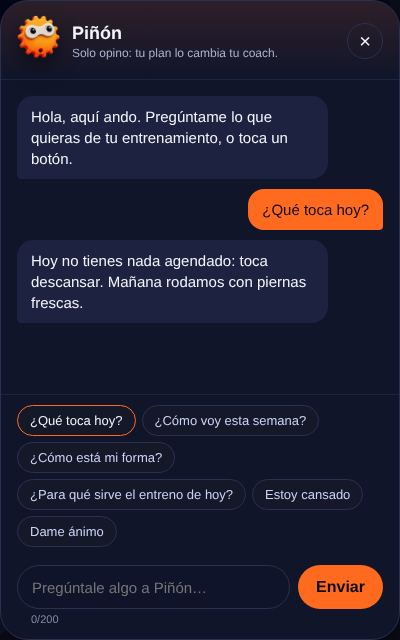 «toca descansar» | 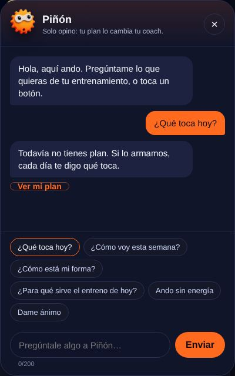 «Todavía no tienes plan» + **Ver mi plan** · botón «Ando sin energía» |
| Sin cuenta, pregunta libre | 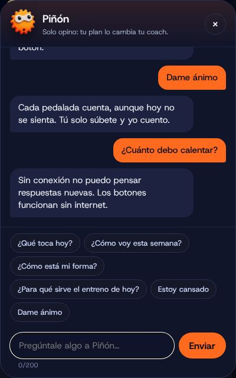 «Sin conexión…» (falso) | 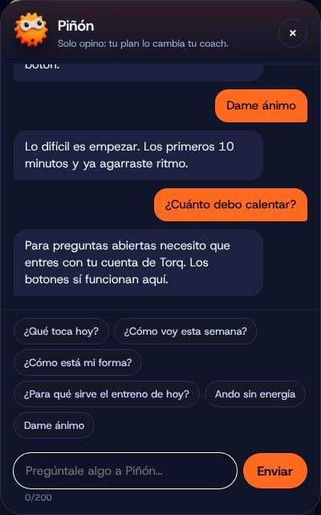 dice por qué y qué sí funciona |
| Celular | 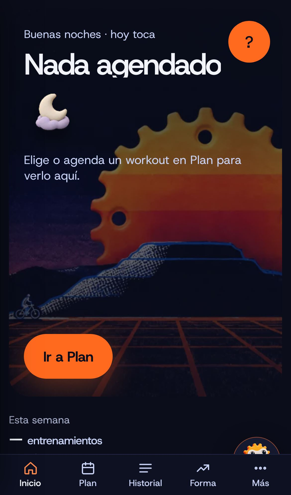 Piñón detrás de la barra | 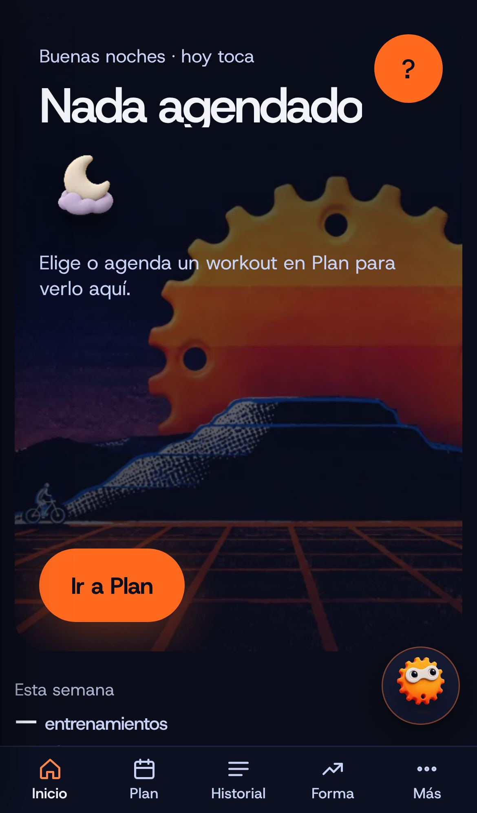 Piñón arriba de la barra |

Más evidencia:
- [Chat abierto](./2026-10-20-ux/img/10-chat-abierto.jpg)
- [Escribiendo](./2026-10-20-ux/img/13-chat-escribiendo.jpg)
- [Respuesta de la IA](./2026-10-20-ux/img/14-chat-respuesta-ia.jpg)
- [Error 403](./2026-10-20-ux/img/15-chat-error-403.jpg) · [Error 429](./2026-10-20-ux/img/15-chat-error-429.jpg) · [Error 500](./2026-10-20-ux/img/15-chat-error-500.jpg)
- [Chat en celular](./2026-10-20-ux/img/52-movil-chat.jpg)

**Objetividad: qué se verifica en cada respuesta.**
- **Respuestas cortas:** ≤ 320 caracteres. Las de los botones miden 56–91.
- **Sin inglés ni siglas sin explicar:** CTL, ATL, TSB, IF, NP.
- **Siempre un camino para seguir:** una acción en la respuesta, o los botones a la vista.
- **Un pedido de cambio no lo «resuelve» Piñón.** La respuesta lo manda al ajuste semanal del coach o al coach humano. El encabezado lo dice: «Solo opino: tu plan lo cambia tu coach».
- **No se gasta IA de más:** la misma pregunta dos veces y el doble clic hacen 1 llamada.

### 3. Crear el plan con el coach IA

```mermaid
sequenceDiagram
  actor A as Atleta
  participant P as Plan
  participant Q as Cuestionario
  participant M as «Crear tu plan»
  participant F as coach-chat
  A->>P: Crear mi plan
  alt perfil incompleto
    P->>Q: abre (sin «Saltar»)
    A->>Q: 29 interacciones · ~4 min
    Q->>M: abre solo al guardar
  else perfil completo
    P->>M: abre
  end
  A->>M: meta + días (L M X J V S D) + Crear plan
  M->>F: create_plan (botón deshabilitado: no gasta 2 de 3)
  Note over M: mensajes rotando cada 4 s<br/>(antes: «CTL/ATL/TSB»)
  alt OK
    F-->>M: nota del coach
    M->>M: relee los workouts de la nube (nuevo)
    A->>M: Entendido
    M->>P: calendario con el plan (antes: vacío hasta recargar)
  else 403 sin acceso
    F-->>M: «subscription_required» → precio y «Suscribirme»<br/>(Ronda 3: la tarjeta ya muestra el precio antes del cuestionario; UX-08 cerrado)
  else 500/502
    F-->>M: «No se pudo crear el plan: …» en español<br/>la meta escrita se conserva, se reintenta en 1 clic
  end
```

| Antes | Después |
|---|---|
| 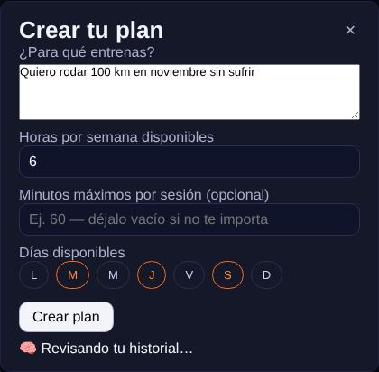 Siglas mientras espera y dos «M». |  |
| 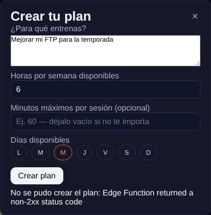 «Edge Function returned a non-2xx status code» | 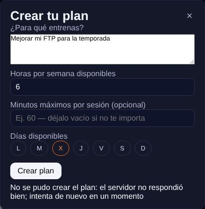 «el servidor no respondió bien; intenta de nuevo en un momento» |
| 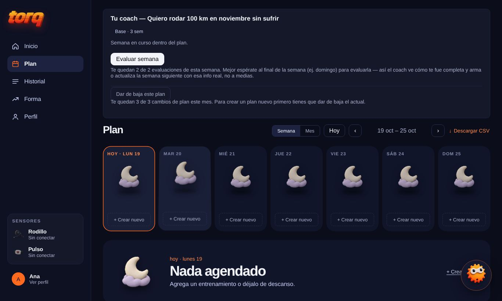 Plan creado y calendario vacío. | 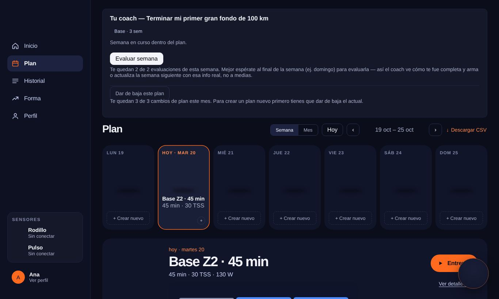 |

### 4. Volver a rodar


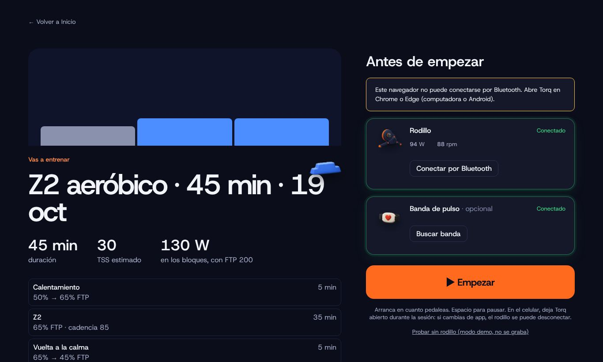

*Antes:* después de la demo, «Antes de empezar» mostraba el rodillo «Conectado» y «Empezar» habilitado, en un navegador **sin Bluetooth**. Lo que se rodara ahí se grababa como sesión real.

---

## Hallazgos

Severidad: **Alta** rompe el flujo, la confianza o los datos · **Media** confunde o hace perder tiempo · **Baja** pulido.

| ID | Hallazgo | Severidad | Evidencia (prueba) | Estado |
|---|---|---|---|---|
| UX-01 | En el login, Enter no hacía nada (los campos no estaban en un `<form>`) | Media | `nube/01 › Enter en la contraseña…` | ✅ Arreglado |
| UX-02 | Errores del login en inglés («Invalid login credentials»); «olvidé mi contraseña» igual | Media | `nube/01 › contraseña equivocada…` | ✅ Arreglado |
| UX-03 | La guía de Inicio dice «Dale a Empezar a rodar» a quien no tiene nada agendado | Media | `nube/01 › la primera pantalla…`, `local/01 › la guía…` | ✅ Arreglado |
| UX-04 | Al guardar el cuestionario vuelves a Inicio «Nada agendado», sin siguiente paso | **Alta** | `nube/01 › Ana/Beto: lo completa y queda claro qué sigue` | ✅ Arreglado: sigue a «Crear tu plan» |
| UX-05 | El cuestionario: 9 secciones, 29 interacciones, ~4 min (meta 90 s) | **Alta** | `nube/01 › guiado por Piñón…` | ✅ Ronda 2: no se acorta (decisión de producto); paso a paso y guiado |
| UX-06 | Si falta un dato, solo aparece un texto al pie de un formulario largo | Media | `nube/01 › si falta un dato…` | ✅ Arreglado: campo marcado, centrado y con foco |
| UX-07 | Tras crear el plan (o evaluar la semana), el calendario sigue vacío hasta recargar: la app nunca relee los workouts que inserta el servidor | **Alta** | `nube/03 › perfil completo…` | ✅ Arreglado |
| UX-08 | Una cuenta fuera de la lista del coach se entera después de 32 interacciones (~4 min) | **Alta** | `nube/03 › cuenta sin acceso…` (deuda + medición) | ✅ Ronda 3: sin acceso, Plan muestra el precio en lugar de «Crear mi plan», e Inicio abre el precio en 1 clic. `nube/03 › cuenta sin acceso…` |
| UX-09 | Días del coach «L M M J V S D»: martes y miércoles iguales | Baja | `nube/03 › los días disponibles…` | ✅ Arreglado: «X» + nombre completo para lector de pantalla |
| UX-10 | Mientras el coach piensa: «Calculando tu forma actual (CTL/ATL/TSB)» | Baja | `nube/03 › mientras piensa…` | ✅ Arreglado |
| UX-11 | Error del coach en inglés cuando la función no manda su propio mensaje | Media | `nube/03 › error sin cuerpo (500)…` | ✅ Arreglado (crear, evaluar y dar de baja) |
| UX-12 | Piñón le receta «toca descansar» a quien todavía no tiene plan: asume que sí hay plan hasta que visitas Plan | **Alta** | `nube/02 › nueva · «¿Qué toca hoy?»…`, `local/01 › Piñón sin cuenta…` | ✅ Arreglado |
| UX-13 | Sin cuenta, una pregunta libre dice «Sin conexión», aunque haya internet | Media | `local/01 › chat sin cuenta…` | ✅ Arreglado |
| UX-14 | Si la IA se cuelga, «escribiendo…» se queda para siempre y no deja preguntar otra cosa | Media | `nube/02 › IA colgada…` | ✅ Arreglado: tope de 25 s |
| UX-15 | El botón «Estoy cansado» da por hecho el género | Baja | `nube/02 › el botón de cansancio…` | ✅ Arreglado: «Ando sin energía» |
| UX-16 | En celular, el botón de Piñón queda detrás de la barra de pestañas: casi no se ve la entrada al chat | **Alta** (celular) | `local/02 › Piñón: el chat se abre en 1 toque…` | ✅ Arreglado |
| UX-17 | La demo deja los simuladores conectados: «Empezar» graba una rodada falsa como real | **Alta** (datos) | `local/01 › después de la demo…` | ✅ Arreglado |
| UX-18 | No hay botón de Piñón en Perfil ni en Resumen (después de rodar es justo cuando uno pregunta «¿cómo me fue?») | Baja | `nube/02 › desde profile/session` | ✅ Ronda 2: chat en ambas pantallas y comentario de cada sesión |
| UX-19 | «Crear tu plan» no se ve como el resto (campo de texto blanco con letra del sistema) y no avisa que tarda 1–2 min | Baja | captura [20](./2026-10-20-ux/img/20-crear-plan-modal.jpg) | 📝 Propuesta P-5 |
| UX-20 | El primer Inicio de alguien nuevo es «Nada agendado» con una luna: se lee como «no hay nada que hacer» | Media | `nube/01 › la primera pantalla da la bienvenida…` | ✅ Ronda 2: bienvenida con Piñón y dos caminos |
| UX-21 | El coach tarda 1–2 min con texto rotando, sin barra ni «cancelar» | Media | `nube/03 › mientras piensa…` | 📝 Propuesta P-5 |
| UX-22 | Diálogos nativos `confirm()`/`alert()` al terminar la rodada, al descartar un borrador y en los sensores sin Bluetooth | Baja | revisión de código | 📝 Propuesta |
| UX-23 | Perfil se guarda solo, sin ningún «guardado» visible | Baja | revisión de código (`perfil.ts`) | 📝 Propuesta |
| UX-24 | No hay registro: el login no dice qué hacer si no tienes invitación | Media | `nube/05 › Lista de espera…` | ✅ Ronda 2: lista de espera |
| UX-25 … UX-28 | Ver [Ronda 2](#lo-que-se-encontró-de-paso-y-se-arregló) | | | ✅ |

---

## Cambios hechos

| Archivo | Cambio | Hallazgo |
|---|---|---|
| `src/ui/screens/login.ts` | Los campos van en un `<form>`, así que Enter entra. `loginErrorText()` traduce los errores de Supabase y dice qué hacer. `autocomplete` y `aria-live` | UX-01, UX-02 |
| `src/ui/password-reset.ts` | El error de «olvidé mi contraseña» sale en español | UX-02 |
| `src/ui/pinon.ts` | Guía de Inicio distinta si no hay nada agendado. El consejo «Crear plan» ya no promete «cuatro cosas» | UX-03 |
| `src/ui/onboarding.ts`, `styles.css` | `flagMissing()`: marca el campo que falta (`.ob-missing`, `aria-invalid`), lo centra y le da el foco. La marca se quita al contestar | UX-06 |
| `src/ui/screens/home.ts`, `calendar.ts` | Al guardar el cuestionario desde el aviso, sigue a «Crear tu plan» (`requestCoachCreate`) | UX-04 |
| `src/ui/state.ts`, `src/ui/coach.ts` | `reloadWorkoutsFromCloud()` corre tras `create_plan` y `weekly_eval`, mientras la persona lee la nota. No borra lo creado en los últimos 2 min que tal vez no terminó de subir | UX-07 |
| `src/ui/coach.ts` | Días «L M X J V S D» con nombre completo. Mensaje de espera sin siglas. `fnErrorText()` en vez del error genérico en inglés | UX-09, UX-10, UX-11 |
| `src/ui/pinon-context.ts` | Mientras no se sepa si hay plan del coach, «hay plan» = hay algo agendado de hoy en adelante | UX-12 |
| `src/sync/pinon-chat.ts`, `src/ui/pinon-chat.ts` | Error nuevo `no_account` con su texto. `timeout: 25 s` en la llamada a la IA | UX-13, UX-14 |
| `src/core/pinon-chat.ts` | Botón «Ando sin energía» | UX-15 |
| `src/ui/styles.css` | En celular, el botón de Piñón va arriba de la barra de pestañas | UX-16 |
| `src/ui/screens/connect.ts` | Al entrar a «Antes de empezar» se desconectan los simuladores que dejó la demo | UX-17 |
| Pruebas unitarias | `login.test.ts` (traducción de errores). `pinon-chat.test.ts`: cada botón escrito a mano cae en su misma respuesta, y ningún botón da por hecho el género | — |
| **Ronda 2** · `src/core/gender.ts` | `genderOf()` / `byGender()`, usado en Piñón (`core/pinon-chat.ts`, `ui/pinon.ts`), Forma (`engine/coaching.ts`, `screens/history.ts`), bienvenida, cuestionario, Resumen y la nota del ajuste semanal | P4 |
| **Ronda 2** · `core/pinon-chat-request.ts`, `pinon-chat/prompt.ts`, `core.gen.js` | La IA de Piñón recibe `gender` y una regla para concordar | P4 |
| **Ronda 2** · `src/ui/onboarding.ts`, `styles.css` | Cuestionario por pasos: guía de Piñón (`obGuideLine`), progreso, puntitos, Atrás/Siguiente, `stepGap()` valida el paso, «Guardar» regresa al paso que falte | P1 |
| **Ronda 2** · `src/ui/screens/home.ts`, `state.ts` | Bienvenida de primera vez (`newcomer`) con «Rodar 30 min suave ahora» y «Armar mi plan con el coach». `createFromTemplate()` sale del generador. `appState.displayName()` | P3 |
| **Ronda 2** · `src/core/pinon-session.ts`, `screens/summary.ts`, `pinon-chat-launcher.ts`, `main.ts` | Comentario de Piñón por sesión. Chat en Resumen y Perfil. `#/session/<id>`. «a medias». Etiquetas en español | P5, UX-26–28 |
| **Ronda 2** · `src/sync/waitlist.ts`, `screens/login.ts`, `supabase/schema.sql` | Lista de espera (tabla `waitlist` con RLS: solo insert) | P3 |
| **Ronda 2** · `src/storage/local-owner.ts` | Sin sesión se guarda el dueño `''`: el modo local deja de borrar todo en cada arranque | UX-25 |
| **Ronda 2** · `scripts/pinon-eval/` | Arnés de calidad de Piñón con la IA real: escenarios, revisiones (probadas), runner, juez opcional, README | P6 |
| Infraestructura | `e2e/` (Supabase simulado, sonda de UX, personas, 8 archivos de pruebas), `playwright.config.ts`, `.env.e2e`, `vitest.config.ts` (Vitest ignora `e2e/`), `e2e/report.mjs` | — |

---

## Propuestas (no implementadas)

> Ronda 2: **P-1 se descartó** (decisión: no se acorta; se hizo guiado). **P-3 y P-4 están hechas.** P-2 está en evaluación (ver arriba). P-5 y P-6 siguen pendientes.

**P-1 · Cuestionario en dos tiempos (UX-05).** *(Descartada.)*
- **Ahora:** se piden 29 respuestas antes del primer plan.
- **Propuesta:** pedir solo lo que decide si es seguro arrancar y con qué intensidad, unas 8 preguntas (~60 s):
  - edad, sexo, peso;
  - «¿alguna condición de salud o medicamento?»;
  - «¿lesión que te impida esfuerzos fuertes?»;
  - experiencia, disciplina, y FTP o «no sé».
- **El resto** (hábitos, años, otras actividades, mejor resultado, pulso en reposo) lo pregunta Piñón después de la primera semana, en el chat o en la evaluación semanal.
- **Cómo medirlo:** la prueba `meta dura: el cuestionario cuesta ≤ 90 s` pasará sola, y Playwright avisará que la «deuda» ya no falla.

**P-2 · Saber antes si la cuenta tiene coach IA (UX-08).**
- **El problema:** la lista de cuentas con acceso vive solo en el servidor (`_shared/coach-access.ts`).
- **Propuesta:** una consulta barata, una RPC `my_ai_access()` o un campo en `profiles`.
  - Si la cuenta no tiene acceso, la tarjeta del coach dice «El coach IA todavía no está abierto para tu cuenta» y no abre el cuestionario.
  - Piñón muestra solo los botones, sin el campo de texto.
- **Hoy esa cuenta desperdicia unos 4 minutos.**

**P-3 · Bienvenida de primera vez (UX-20).**
- **Propuesta:** en el primer Inicio de una cuenta sin sesiones ni plan, cambiar «Nada agendado 🌙» por:
  - «Bienvenida/o, Ana. ¿Por dónde empezamos?»
  - Dos caminos claros: **Rodar 30 min suave ahora** (genera el Z2 y va a «Antes de empezar») y **Armar mi plan con el coach** (≈4 min, o ≈1 min con P-1).
  - Piñón saluda una sola vez, con este mismo texto, en lugar de la guía.

**P-4 · Piñón donde se pregunta (UX-18).**
- **Propuesta:** botón de Piñón también en **Resumen**, con un botón rápido «¿Cómo me fue?» que use las métricas de esa sesión, y en **Perfil**.
- **Hoy hacen falta 2 clics.**

**P-5 · Espera del coach (UX-19, UX-21).**
- **Antes de enviar:** «Tarda 1–2 minutos; puedes cerrar esto y te aviso».
- **Mientras espera:**
  - una barra con las etapas reales (historial → periodización → bloque → descripciones);
  - un «Cerrar y avisarme» que deje la creación corriendo en segundo plano y celebre con Piñón al terminar.
- **Estilos:** el formulario «Crear tu plan» con los mismos tokens del cuestionario.

**P-6 · Diálogos propios** en lugar de `confirm()`/`alert()`, y un «Guardado ✓» discreto en Perfil (UX-22, UX-23).

---

## Preguntas abiertas para producto

> Contestadas el 20-oct: las respuestas y lo que se hizo están en [Ronda 2](#tus-respuestas-y-qué-se-hizo-con-cada-una). Los planes también quedaron decididos (ver [Decisión de planes](#decisión-de-planes-p-2)). Abajo, las preguntas originales.

1. **Cuestionario (P-1):** ¿el método de Joe acepta pedir lo de salud y experiencia primero, y el resto después de la semana 1? ¿O el plan necesita todo desde el día uno?
2. **Acceso al coach (P-2):** ¿la lista de cuentas permitidas se queda un tiempo? Si sí, ¿avisamos antes del cuestionario o se lo dejamos contestar igual, porque le sirve al coach humano?
3. **Registro (UX-24):** ¿solo por invitación es definitivo? ¿Qué debe ver quien llega sin invitación: «pide acceso» con un correo, o una lista de espera?
4. **Tono y género:** muchos textos usan masculino genérico («vienes cargado», «estás fresco», «bienvenido»). ¿Neutralizamos los textos o usamos el sexo del perfil para concordar?
5. **Piñón después de rodar (P-4):** ¿quieres que Piñón comente cada sesión en el Resumen (sin IA, con las métricas), o solo a pedido?
6. **Calidad real de Piñón:** esta suite no mide lo que contesta Haiku. ¿Armamos un arnés tipo `coach-lab` para `pinon-chat`? La idea: 30 preguntas reales × 4 perfiles, con rúbrica de objetividad, brevedad, seguridad y «no cambia el plan». Necesita red a Supabase o la API.
7. **Voz:** la meta fue el chat. Si algún día quieres «llamar» a Piñón por voz, en rodillo tiene sentido (manos ocupadas): ¿lo exploramos como fase aparte?

---

## Cómo correr las pruebas

```bash
npm install
npm run test:ux            # 89 pruebas, ~2.5 min, levanta solo las dos copias de la app
npm run test:ux:report     # e2e/.out → docs/evaluaciones/2026-10-20-ux/resultados.md
npx playwright test -g "Piñón"          # solo un grupo
npx playwright show-trace e2e/.out/artifacts/<prueba>/trace.zip   # ver paso a paso una que falló
ANTHROPIC_API_KEY=... npm run pinon:eval -- --judge   # calidad real de Piñón (ver scripts/pinon-eval/README.md)
```

**Archivos de la suite:**
- `e2e/support/mock-supabase.ts`: el Supabase simulado. Cada prueba decide qué contesta cada función y con cuánta demora.
- `e2e/support/ux.ts`: la sonda de UX:
  - cuenta clics, campos y segundos;
  - detecta inglés y siglas;
  - toma capturas;
  - guarda el recorrido en `e2e/.out/journeys/`.
- `e2e/support/flows.ts`: lo que hace una persona (entrar, contestar el cuestionario, abrir el chat, preguntar).
- `e2e/support/seed.ts` y `e2e/fixtures/perfil-*.json`: personas con perfil completo, workouts y plan activo.

**Convenciones de las pruebas:**
- **Deuda conocida:** `test.fail(true, 'UX-xx …')`. La suite sigue verde, pero cuando alguien la arregle Playwright avisa «Expected to fail, but passed» y se quita la marca.
- **Workers:** se corre con 3, porque las mediciones de «al instante» no aguantan más carga en la máquina.
