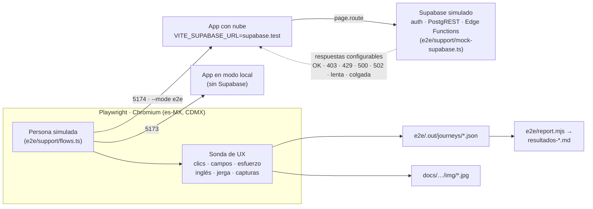
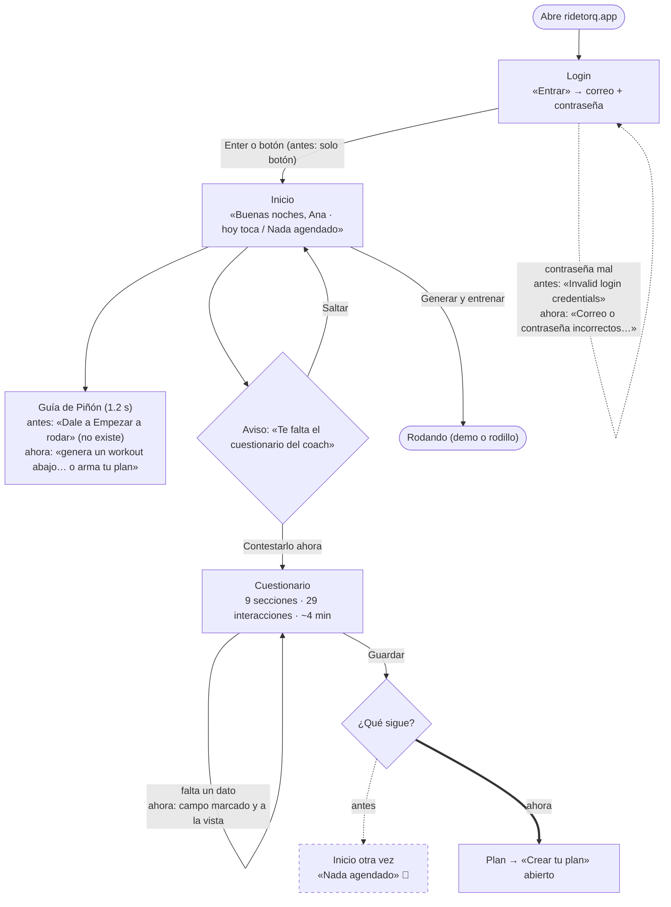
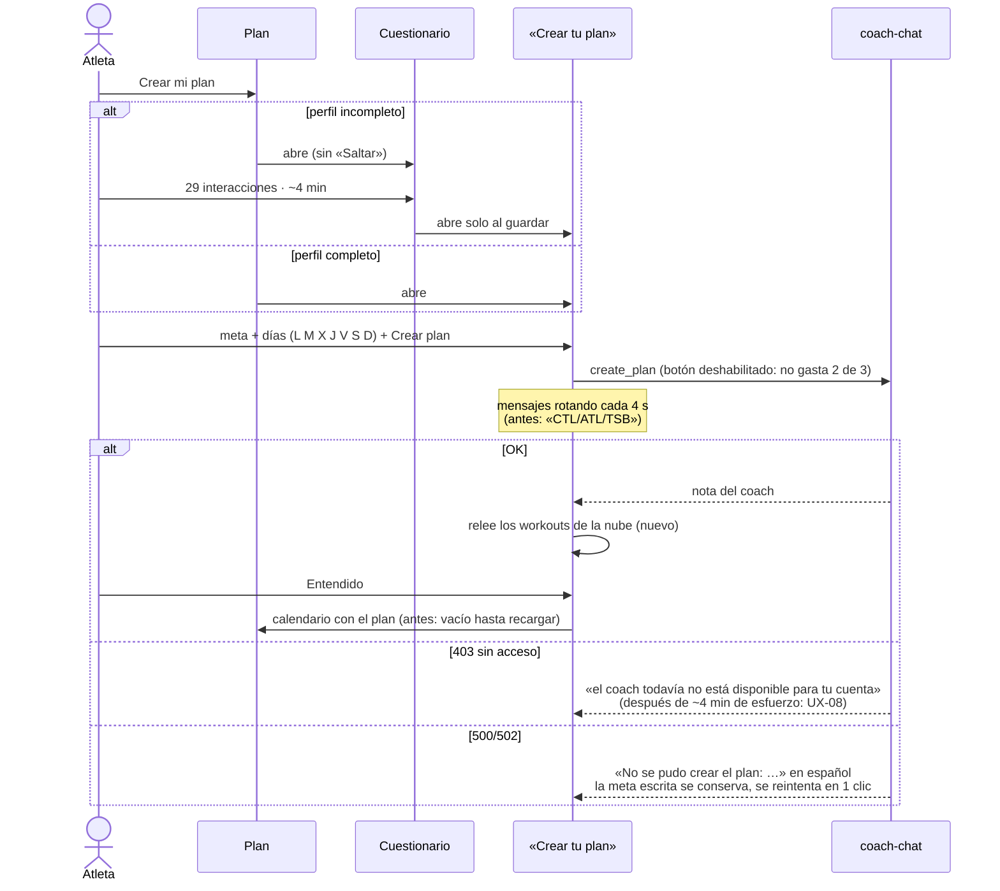
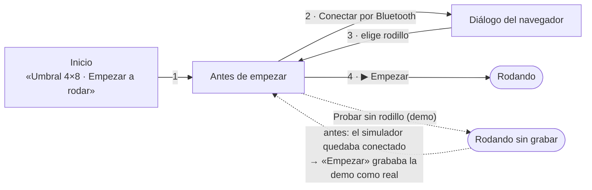

# Evaluación de UX: entrar, sentirse bienvenido y hablar con Piñón
20 de octubre de 2026 · **Método:** pruebas de punta a punta con Playwright en Chromium real, contra la app corriendo en local con dos configuraciones: sin nube (modo local) y con un Supabase **simulado** (login, perfil, Piñón y coach IA). Cada prueba es una persona con un objetivo; se cuentan sus clics, campos y segundos de esfuerzo, y se guardan capturas como evidencia. · **Versión evaluada:** `main` en `d1ec0f4`. · **Suite:** `e2e/` (77 pruebas), `npm run test:ux`.

**Decisiones de producto para esta revisión:**
- **Alcance:** pruebas, documentación y arreglos rápidos. Los cambios grandes de flujo quedan como propuesta.
- **IA evaluada:** el chat con Piñón y el coach que arma el plan.
- **Metas de clics (estrictas):**
  - ≤ 3 clics de abrir la app a hablar con Piñón.
  - ≤ 5 clics de abrir la app a estar rodando.
  - Cuestionario inicial ≤ 90 s de esfuerzo.
- **Backend simulado:** desde el entorno de pruebas no hay red a producción.

**Limitaciones:**
- **La calidad de lo que contesta la IA real no se evaluó aquí.**
  - Las respuestas de Piñón y del coach son fijas: se prueba la experiencia alrededor (llegar, esperar, errores, seguir), no lo que diría Haiku o Sonnet.
  - La calidad del coach ya está medida en [`2026-10-09-hallazgos-coach-torq.md`](./2026-10-09-hallazgos-coach-torq.md). La de Piñón queda como pregunta abierta (P-6).
- **El Bluetooth real no se puede automatizar.** El camino «con rodillo» se mide hasta «Antes de empezar» y suma los 3 clics que faltan (conectar, elegir en el diálogo del navegador y Empezar).
- **El esfuerzo es una estimación**, inspirada en el modelo KLM:
  - 2.5 s por clic, 5 s por campo y 3 s por pausa a leer.
  - Los textos largos se leen a 200 palabras por minuto.
  - Sirve para comparar flujos entre sí, no como cronómetro.

---

## Resumen ejecutivo
- **Llegar a Piñón es fácil.**
  - Basta 1 clic desde Inicio, Plan, Forma e Historial, y 2 desde Perfil o Resumen. La meta era ≤ 3.
  - Los 6 botones rápidos contestan en 0.35–0.93 s, con 56–91 caracteres, sin llamar a la IA y sin siglas.
  - Pedir un cambio de plan se contesta sin IA y manda a quien sí puede hacerlo.
- **Rodar también es corto.**
  - Sin cuenta, una persona nueva está pedaleando en modo demo con **3 clics**.
  - Con plan y entreno del día, llega a «Antes de empezar» en **1 clic**: unos 4 en total con rodillo real.
- **Lo que más costaba antes de esta revisión**: 18 de 77 pruebas fallaban. Ahora fallan 0.
  - **Piñón le decía a una persona recién llegada «toca descansar»** cuando lo que pasaba era que no tenía plan (UX-12). Rompía justo la objetividad que pedimos.
  - **Al terminar el cuestionario no había siguiente paso** (UX-04): volvías a «Nada agendado».
  - **Tras crear el plan con el coach, el calendario seguía vacío** hasta recargar la app (UX-07).
  - **En celular, el botón de Piñón quedaba tapado** por la barra de pestañas (UX-16).
  - **La demo dejaba el simulador conectado.** «Empezar» quedaba habilitado y grababa una rodada falsa como real (UX-17).
  - **Errores en inglés** en el login y en el coach («Invalid login credentials», «Edge Function returned a non-2xx status code»).
- **Lo que no se arregló, por ser de producto o de plataforma:**
  - **El cuestionario cuesta unos 4 minutos** (29 interacciones), contra una meta de 90 s (UX-05).
  - **Una cuenta sin acceso al coach se entera después de unos 4 minutos** de cuestionario y formulario (UX-08).
  - Las dos quedan como pruebas de «deuda conocida» que avisarán cuando se resuelvan.

## Metas: antes y después

| Meta | Medido antes | Medido después | Estado |
|---|---|---|---|
| Abrir la app → hablar con Piñón (≤ 3 clics) | 1 clic (2 desde Perfil/Resumen) | igual | ✅ |
| Respuestas de botones al instante y sin IA | 0.35–0.93 s · 0 llamadas | igual | ✅ |
| Respuesta de Piñón objetiva para alguien nuevo | «Hoy no tienes nada agendado: toca descansar» | «Todavía no tienes plan…» + «Ver mi plan» | ✅ arreglado |
| Abrir la app → rodando, sin cuenta (≤ 5 clics) | 3 clics | 3 clics | ✅ |
| Abrir la app → rodando, con plan (≤ 5 clics) | 1 + 3 con rodillo = 4 | igual | ✅ |
| Login → Inicio | 2 clics + 2 campos; Enter no hacía nada | Enter entra | ✅ arreglado |
| Cuestionario ≤ 90 s | ~244–249 s (29 interacciones + lectura) | igual | ❌ deuda UX-05 |
| Cuestionario → siguiente paso claro | volvía a Inicio «Nada agendado» | abre «Crear tu plan» | ✅ arreglado |
| Perfil completo → plan creado (≤ 8 interacciones) | 8, pero calendario vacío | 8, calendario con el plan | ✅ arreglado |
| IA colgada no deja «escribiendo…» para siempre | se quedaba para siempre | a los 25 s avisa y deja seguir | ✅ arreglado |

Tablas completas por prueba: [antes](./2026-10-20-ux/resultados-antes.md) · [después](./2026-10-20-ux/resultados-despues.md).

---

## Cómo se probó



### Personas

| Persona | Quién es | Estado inicial | Dónde se usa |
|---|---|---|---|
| **Ana**, novata | Mujer, 34 años, sin estructura, sin FTP ni pulso máx. | Cuenta nueva, sin perfil, sin plan | Primer ingreso, cuestionario, chat «nueva», coach |
| **Beto**, experimentado | Hombre, 41, XC, FTP 265 W, FC máx. 186 | Perfil completo; entreno de hoy o plan activo | Cuestionario, chat «con entreno», volver a rodar |
| **Carla**, sin acceso | Cuenta que no está en la lista del coach IA | Sin perfil | Coach 403, chat 403 |
| **Sin cuenta** | Quien abre un despliegue sin nube | Nada | Modo local, demo, celular |
| **Celular** | Cualquiera en un iPhone 13 (390×664) | Nada | Recorrido de pantallas, chat |

### Matriz de comportamientos

| Comportamiento | Ana | Beto | Carla | Sin cuenta | Celular |
|---|:-:|:-:|:-:|:-:|:-:|
| Entra con Enter, se equivoca de contraseña, deja campos vacíos | ✓ | | | | |
| Link profundo sin sesión (`#/form`) | ✓ | | | | |
| Lee la guía de Piñón / la apaga | ✓ | | | ✓ | |
| Contesta el cuestionario con prisa / lo deja incompleto / lo salta | ✓ | ✓ | | | |
| Abre a Piñón desde cada pantalla | | ✓ | | ✓ | ✓ |
| Toca cada botón rápido (5 × 2 perfiles) | ✓ | ✓ | | ✓ | |
| Pregunta libre · repetida (caché) · pide un cambio · doble clic · 250 caracteres | | ✓ | | ✓ | |
| IA: 403 · 429 · 500 · lenta 8 s · colgada 60 s | | ✓ | ✓ | | |
| Crea plan · reintenta tras 502/500 · doble clic en «Crear plan» | ✓ | | ✓ | | |
| Vuelve con entreno hoy / tras 6 días sin rodar | | ✓ | | | |
| Demo sin rodillo y regreso a «Antes de empezar» | | | | ✓ | |
| Sin scroll horizontal, Piñón visible y chat dentro de la pantalla | | | | | ✓ |

---

## Flujos

### 1. Primer ingreso (nube)



| Antes | Después |
|---|---|
|  La guía promete un botón que no está. |  La guía dice qué hacer con lo que sí hay. |
|  |  |
|  Solo un texto al pie. |  El campo queda marcado, centrado y con el foco. |
|  Vuelve a Inicio sin siguiente paso. |  Sigue directo a «Crear tu plan» (días L M **X** J V S D). |

### 2. Hablar con Piñón


| Situación | Antes | Después |
|---|---|---|
| Ana, sin plan, toca «¿Qué toca hoy?» |  «toca descansar» |  «Todavía no tienes plan» + **Ver mi plan** · botón «Ando sin energía» |
| Sin cuenta, pregunta libre |  «Sin conexión…» (falso) |  dice por qué y qué sí funciona |
| Celular |  Piñón detrás de la barra |  Piñón arriba de la barra |

Más evidencia:
- [Chat abierto](./2026-10-20-ux/img/10-chat-abierto.jpg)
- [Escribiendo](./2026-10-20-ux/img/13-chat-escribiendo.jpg)
- [Respuesta de la IA](./2026-10-20-ux/img/14-chat-respuesta-ia.jpg)
- [Error 403](./2026-10-20-ux/img/15-chat-error-403.jpg) · [Error 429](./2026-10-20-ux/img/15-chat-error-429.jpg) · [Error 500](./2026-10-20-ux/img/15-chat-error-500.jpg)
- [Chat en celular](./2026-10-20-ux/img/52-movil-chat.jpg)

**Objetividad: qué se verifica en cada respuesta.**
- **Respuestas cortas:** ≤ 320 caracteres. Las de los botones miden 56–91.
- **Sin inglés ni siglas sin explicar:** CTL, ATL, TSB, IF, NP.
- **Siempre un camino para seguir:** una acción en la respuesta, o los botones a la vista.
- **Un pedido de cambio no lo «resuelve» Piñón.** La respuesta lo manda al ajuste semanal del coach o al coach humano. El encabezado lo dice: «Solo opino: tu plan lo cambia tu coach».
- **No se gasta IA de más:** la misma pregunta dos veces y el doble clic hacen 1 llamada.

### 3. Crear el plan con el coach IA



| Antes | Después |
|---|---|
|  Siglas mientras espera y dos «M». |  |
|  «Edge Function returned a non-2xx status code» |  «el servidor no respondió bien; intenta de nuevo en un momento» |
|  Plan creado y calendario vacío. |  |

### 4. Volver a rodar




*Antes:* después de la demo, «Antes de empezar» mostraba el rodillo «Conectado» y «Empezar» habilitado, en un navegador **sin Bluetooth**. Lo que se rodara ahí se grababa como sesión real.

---

## Hallazgos

Severidad: **Alta** rompe el flujo, la confianza o los datos · **Media** confunde o hace perder tiempo · **Baja** pulido.

| ID | Hallazgo | Severidad | Evidencia (prueba) | Estado |
|---|---|---|---|---|
| UX-01 | En el login, Enter no hacía nada (los campos no estaban en un `<form>`) | Media | `nube/01 › Enter en la contraseña…` | ✅ Arreglado |
| UX-02 | Errores del login en inglés («Invalid login credentials»); «olvidé mi contraseña» igual | Media | `nube/01 › contraseña equivocada…` | ✅ Arreglado |
| UX-03 | La guía de Inicio dice «Dale a Empezar a rodar» a quien no tiene nada agendado | Media | `nube/01 › la primera pantalla…`, `local/01 › la guía…` | ✅ Arreglado |
| UX-04 | Al guardar el cuestionario vuelves a Inicio «Nada agendado», sin siguiente paso | **Alta** | `nube/01 › Ana/Beto: lo completa y queda claro qué sigue` | ✅ Arreglado: sigue a «Crear tu plan» |
| UX-05 | El cuestionario: 9 secciones, 29 interacciones, ~4 min (meta 90 s) | **Alta** | `nube/01 › meta dura…` (deuda) | 📝 Propuesta P-1 |
| UX-06 | Si falta un dato, solo aparece un texto al pie de un formulario largo | Media | `nube/01 › si falta un dato…` | ✅ Arreglado: campo marcado, centrado y con foco |
| UX-07 | Tras crear el plan (o evaluar la semana), el calendario sigue vacío hasta recargar: la app nunca relee los workouts que inserta el servidor | **Alta** | `nube/03 › perfil completo…` | ✅ Arreglado |
| UX-08 | Una cuenta fuera de la lista del coach se entera después de 32 interacciones (~4 min) | **Alta** | `nube/03 › cuenta sin acceso…` (deuda + medición) | 📝 Propuesta P-2 |
| UX-09 | Días del coach «L M M J V S D»: martes y miércoles iguales | Baja | `nube/03 › los días disponibles…` | ✅ Arreglado: «X» + nombre completo para lector de pantalla |
| UX-10 | Mientras el coach piensa: «Calculando tu forma actual (CTL/ATL/TSB)» | Baja | `nube/03 › mientras piensa…` | ✅ Arreglado |
| UX-11 | Error del coach en inglés cuando la función no manda su propio mensaje | Media | `nube/03 › error sin cuerpo (500)…` | ✅ Arreglado (crear, evaluar y dar de baja) |
| UX-12 | Piñón le receta «toca descansar» a quien todavía no tiene plan: asume que sí hay plan hasta que visitas Plan | **Alta** | `nube/02 › nueva · «¿Qué toca hoy?»…`, `local/01 › Piñón sin cuenta…` | ✅ Arreglado |
| UX-13 | Sin cuenta, una pregunta libre dice «Sin conexión», aunque haya internet | Media | `local/01 › chat sin cuenta…` | ✅ Arreglado |
| UX-14 | Si la IA se cuelga, «escribiendo…» se queda para siempre y no deja preguntar otra cosa | Media | `nube/02 › IA colgada…` | ✅ Arreglado: tope de 25 s |
| UX-15 | El botón «Estoy cansado» da por hecho el género | Baja | `nube/02 › el botón de cansancio…` | ✅ Arreglado: «Ando sin energía» |
| UX-16 | En celular, el botón de Piñón queda detrás de la barra de pestañas: casi no se ve la entrada al chat | **Alta** (celular) | `local/02 › Piñón: el chat se abre en 1 toque…` | ✅ Arreglado |
| UX-17 | La demo deja los simuladores conectados: «Empezar» graba una rodada falsa como real | **Alta** (datos) | `local/01 › después de la demo…` | ✅ Arreglado |
| UX-18 | No hay botón de Piñón en Perfil ni en Resumen (después de rodar es justo cuando uno pregunta «¿cómo me fue?») | Baja | `nube/02 › desde profile/session` (2 clics, dentro de la meta) | 📝 Propuesta P-4 |
| UX-19 | «Crear tu plan» no se ve como el resto (campo de texto blanco con letra del sistema) y no avisa que tarda 1–2 min | Baja | captura [20](./2026-10-20-ux/img/20-crear-plan-modal.jpg) | 📝 Propuesta P-5 |
| UX-20 | El primer Inicio de alguien nuevo es «Nada agendado» con una luna: se lee como «no hay nada que hacer» | Media | captura [03](./2026-10-20-ux/img/03-bienvenida.jpg) | 📝 Propuesta P-3 |
| UX-21 | El coach tarda 1–2 min con texto rotando, sin barra ni «cancelar» | Media | `nube/03 › mientras piensa…` | 📝 Propuesta P-5 |
| UX-22 | Diálogos nativos `confirm()`/`alert()` al terminar la rodada, al descartar un borrador y en los sensores sin Bluetooth | Baja | revisión de código | 📝 Propuesta |
| UX-23 | Perfil se guarda solo, sin ningún «guardado» visible | Baja | revisión de código (`perfil.ts`) | 📝 Propuesta |
| UX-24 | No hay registro: el login no dice qué hacer si no tienes invitación | Media | captura [01](./2026-10-20-ux/img/01-login.jpg) | ❓ Pregunta P-7 |

---

## Cambios hechos

| Archivo | Cambio | Hallazgo |
|---|---|---|
| `src/ui/screens/login.ts` | Los campos van en un `<form>`, así que Enter entra. `loginErrorText()` traduce los errores de Supabase y dice qué hacer. `autocomplete` y `aria-live` | UX-01, UX-02 |
| `src/ui/password-reset.ts` | El error de «olvidé mi contraseña» sale en español | UX-02 |
| `src/ui/pinon.ts` | Guía de Inicio distinta si no hay nada agendado. El consejo «Crear plan» ya no promete «cuatro cosas» | UX-03 |
| `src/ui/onboarding.ts`, `styles.css` | `flagMissing()`: marca el campo que falta (`.ob-missing`, `aria-invalid`), lo centra y le da el foco. La marca se quita al contestar | UX-06 |
| `src/ui/screens/home.ts`, `calendar.ts` | Al guardar el cuestionario desde el aviso, sigue a «Crear tu plan» (`requestCoachCreate`) | UX-04 |
| `src/ui/state.ts`, `src/ui/coach.ts` | `reloadWorkoutsFromCloud()` corre tras `create_plan` y `weekly_eval`, mientras la persona lee la nota. No borra lo creado en los últimos 2 min que tal vez no terminó de subir | UX-07 |
| `src/ui/coach.ts` | Días «L M X J V S D» con nombre completo. Mensaje de espera sin siglas. `fnErrorText()` en vez del error genérico en inglés | UX-09, UX-10, UX-11 |
| `src/ui/pinon-context.ts` | Mientras no se sepa si hay plan del coach, «hay plan» = hay algo agendado de hoy en adelante | UX-12 |
| `src/sync/pinon-chat.ts`, `src/ui/pinon-chat.ts` | Error nuevo `no_account` con su texto. `timeout: 25 s` en la llamada a la IA | UX-13, UX-14 |
| `src/core/pinon-chat.ts` | Botón «Ando sin energía» | UX-15 |
| `src/ui/styles.css` | En celular, el botón de Piñón va arriba de la barra de pestañas | UX-16 |
| `src/ui/screens/connect.ts` | Al entrar a «Antes de empezar» se desconectan los simuladores que dejó la demo | UX-17 |
| Pruebas unitarias | `login.test.ts` (traducción de errores). `pinon-chat.test.ts`: cada botón escrito a mano cae en su misma respuesta, y ningún botón da por hecho el género | — |
| Infraestructura | `e2e/` (Supabase simulado, sonda de UX, personas, 7 archivos de pruebas), `playwright.config.ts`, `.env.e2e`, `vitest.config.ts` (Vitest ignora `e2e/`), `e2e/report.mjs` | — |

---

## Propuestas (no implementadas)

**P-1 · Cuestionario en dos tiempos (UX-05).**
- **Ahora:** se piden 29 respuestas antes del primer plan.
- **Propuesta:** pedir solo lo que decide si es seguro arrancar y con qué intensidad, unas 8 preguntas (~60 s):
  - edad, sexo, peso;
  - «¿alguna condición de salud o medicamento?»;
  - «¿lesión que te impida esfuerzos fuertes?»;
  - experiencia, disciplina, y FTP o «no sé».
- **El resto** (hábitos, años, otras actividades, mejor resultado, pulso en reposo) lo pregunta Piñón después de la primera semana, en el chat o en la evaluación semanal.
- **Cómo medirlo:** la prueba `meta dura: el cuestionario cuesta ≤ 90 s` pasará sola, y Playwright avisará que la «deuda» ya no falla.

**P-2 · Saber antes si la cuenta tiene coach IA (UX-08).**
- **El problema:** la lista de cuentas con acceso vive solo en el servidor (`_shared/coach-access.ts`).
- **Propuesta:** una consulta barata, una RPC `my_ai_access()` o un campo en `profiles`.
  - Si la cuenta no tiene acceso, la tarjeta del coach dice «El coach IA todavía no está abierto para tu cuenta» y no abre el cuestionario.
  - Piñón muestra solo los botones, sin el campo de texto.
- **Hoy esa cuenta desperdicia unos 4 minutos.**

**P-3 · Bienvenida de primera vez (UX-20).**
- **Propuesta:** en el primer Inicio de una cuenta sin sesiones ni plan, cambiar «Nada agendado 🌙» por:
  - «Bienvenida/o, Ana. ¿Por dónde empezamos?»
  - Dos caminos claros: **Rodar 30 min suave ahora** (genera el Z2 y va a «Antes de empezar») y **Armar mi plan con el coach** (≈4 min, o ≈1 min con P-1).
  - Piñón saluda una sola vez, con este mismo texto, en lugar de la guía.

**P-4 · Piñón donde se pregunta (UX-18).**
- **Propuesta:** botón de Piñón también en **Resumen**, con un botón rápido «¿Cómo me fue?» que use las métricas de esa sesión, y en **Perfil**.
- **Hoy hacen falta 2 clics.**

**P-5 · Espera del coach (UX-19, UX-21).**
- **Antes de enviar:** «Tarda 1–2 minutos; puedes cerrar esto y te aviso».
- **Mientras espera:**
  - una barra con las etapas reales (historial → periodización → bloque → descripciones);
  - un «Cerrar y avisarme» que deje la creación corriendo en segundo plano y celebre con Piñón al terminar.
- **Estilos:** el formulario «Crear tu plan» con los mismos tokens del cuestionario.

**P-6 · Diálogos propios** en lugar de `confirm()`/`alert()`, y un «Guardado ✓» discreto en Perfil (UX-22, UX-23).

---

## Preguntas abiertas para producto

1. **Cuestionario (P-1):** ¿el método de Joe acepta pedir lo de salud y experiencia primero, y el resto después de la semana 1? ¿O el plan necesita todo desde el día uno?
2. **Acceso al coach (P-2):** ¿la lista de cuentas permitidas se queda un tiempo? Si sí, ¿avisamos antes del cuestionario o se lo dejamos contestar igual, porque le sirve al coach humano?
3. **Registro (UX-24):** ¿solo por invitación es definitivo? ¿Qué debe ver quien llega sin invitación: «pide acceso» con un correo, o una lista de espera?
4. **Tono y género:** muchos textos usan masculino genérico («vienes cargado», «estás fresco», «bienvenido»). ¿Neutralizamos los textos o usamos el sexo del perfil para concordar?
5. **Piñón después de rodar (P-4):** ¿quieres que Piñón comente cada sesión en el Resumen (sin IA, con las métricas), o solo a pedido?
6. **Calidad real de Piñón:** esta suite no mide lo que contesta Haiku. ¿Armamos un arnés tipo `coach-lab` para `pinon-chat`? La idea: 30 preguntas reales × 4 perfiles, con rúbrica de objetividad, brevedad, seguridad y «no cambia el plan». Necesita red a Supabase o la API.
7. **Voz:** la meta fue el chat. Si algún día quieres «llamar» a Piñón por voz, en rodillo tiene sentido (manos ocupadas): ¿lo exploramos como fase aparte?

---

## Cómo correr las pruebas

```bash
npm install
npm run test:ux            # 77 pruebas, ~2.5 min, levanta solo las dos copias de la app
npm run test:ux:report     # e2e/.out → docs/evaluaciones/2026-10-20-ux/resultados.md
npx playwright test -g "Piñón"          # solo un grupo
npx playwright show-trace e2e/.out/artifacts/<prueba>/trace.zip   # ver paso a paso una que falló
```

**Archivos de la suite:**
- `e2e/support/mock-supabase.ts`: el Supabase simulado. Cada prueba decide qué contesta cada función y con cuánta demora.
- `e2e/support/ux.ts`: la sonda de UX:
  - cuenta clics, campos y segundos;
  - detecta inglés y siglas;
  - toma capturas;
  - guarda el recorrido en `e2e/.out/journeys/`.
- `e2e/support/flows.ts`: lo que hace una persona (entrar, contestar el cuestionario, abrir el chat, preguntar).
- `e2e/support/seed.ts` y `e2e/fixtures/perfil-*.json`: personas con perfil completo, workouts y plan activo.

**Convenciones de las pruebas:**
- **Deuda conocida:** `test.fail(true, 'UX-xx …')`. La suite sigue verde, pero cuando alguien la arregle Playwright avisa «Expected to fail, but passed» y se quita la marca.
- **Workers:** se corre con 3, porque las mediciones de «al instante» no aguantan más carga en la máquina.
